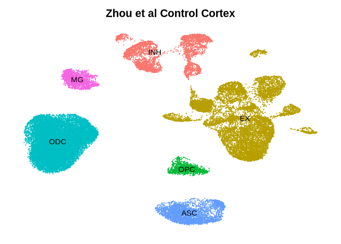
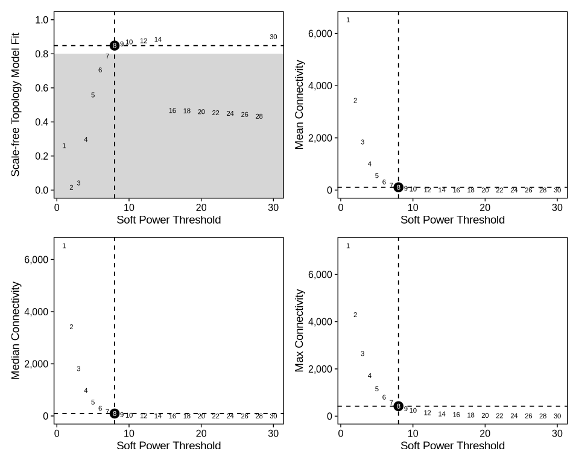
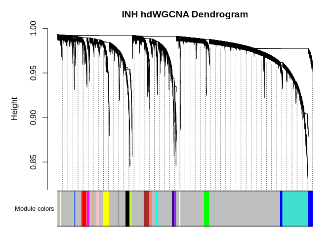
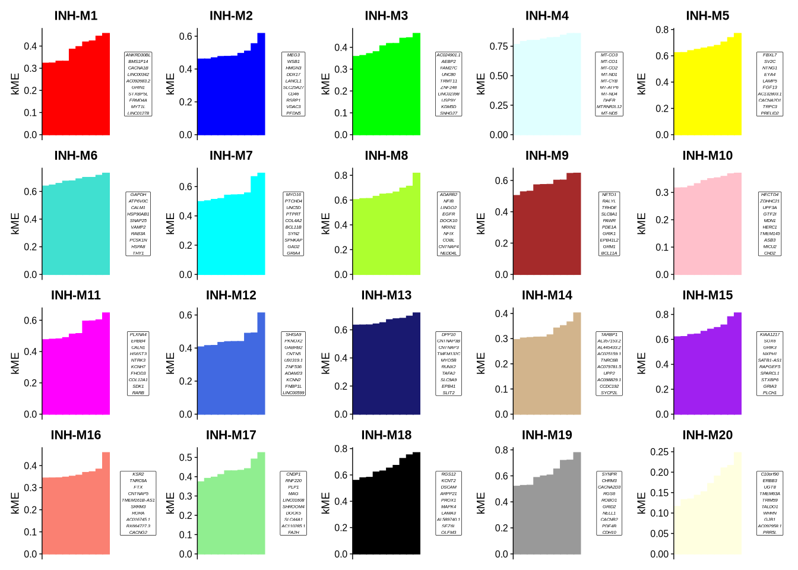
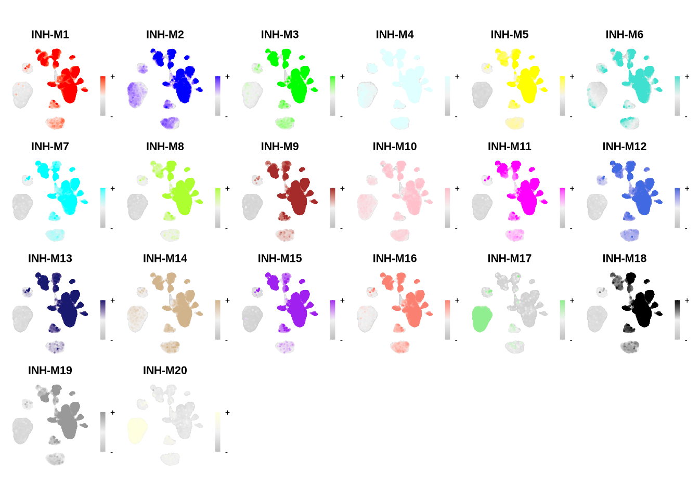
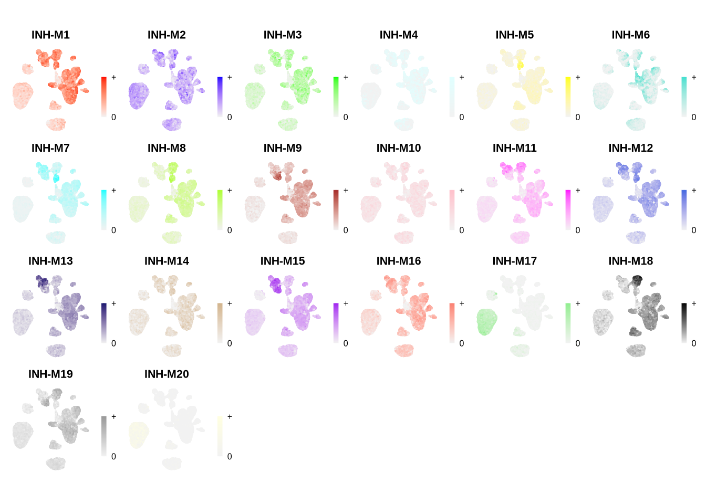
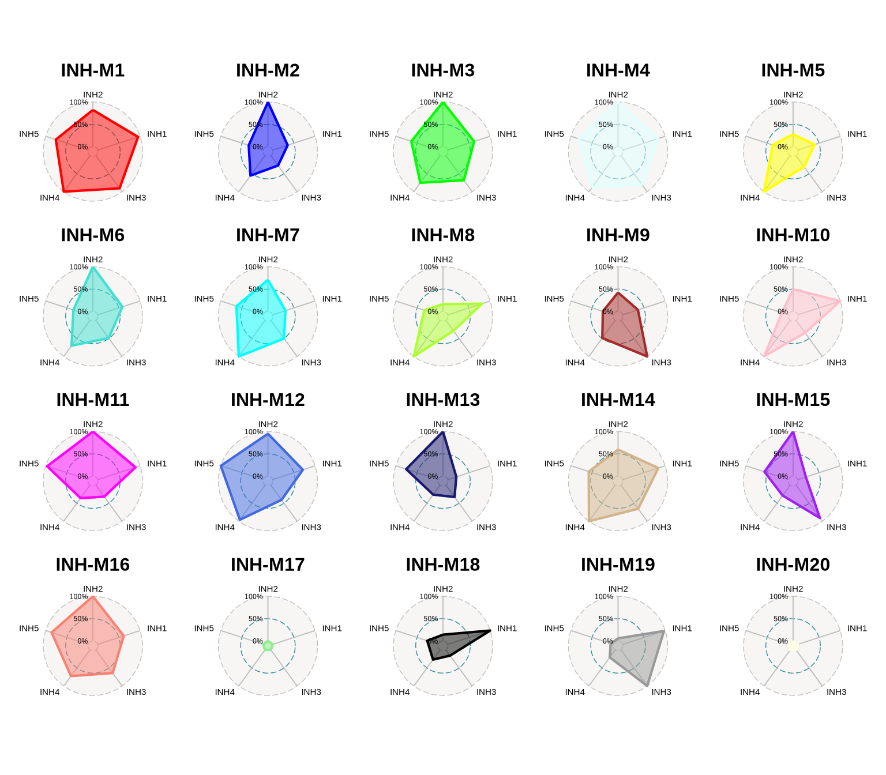
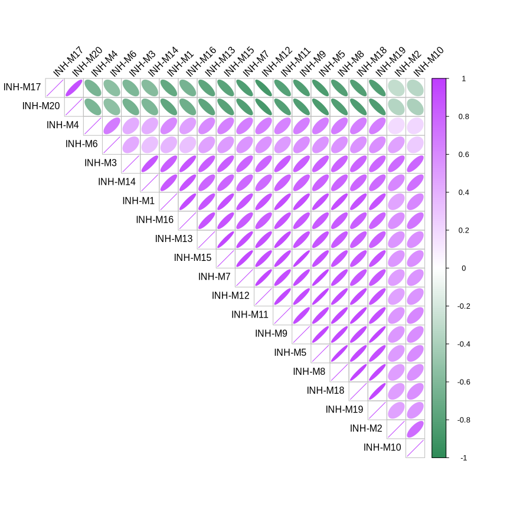
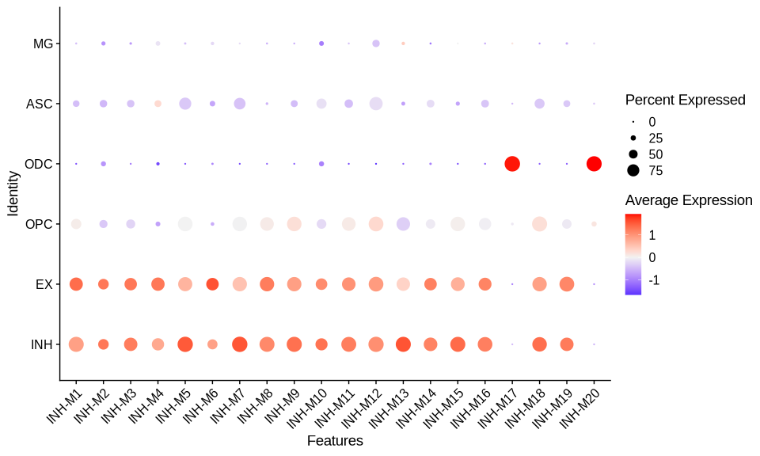

## Introduction

This tutorial covers the basics of using hdWGCNA to perform co-expression network
analysis on single-cell data. Here, we start with a processed
single-nucleus RNA-seq (snRNA-seq) dataset of human cortical samples from
[this publication](https://www.nature.com/articles/s41591-019-0695-9). This
dataset has already been fully processed using a standard single-cell
transcritpomics analysis pipeline such as [Seurat](https://satijalab.org/seurat/)
or [Scanpy](https://scanpy.readthedocs.io/en/stable/). If you would
like to follow this tutorial using your own dataset, you first need to satisfy the
following prerequisites:

* A single-cell or single-nucleus transcriptomics dataset in [Seurat format](https://www.rdocumentation.org/packages/Seurat/versions/3.0.1/topics/CreateSeuratObject).
* Normalize the gene expression matrix [NormalizeData](https://satijalab.org/seurat/reference/normalizedata).
* Identify highly variable genes [VariableFeatures](https://satijalab.org/seurat/reference/findvariablefeatures).
* Scale the normalized expression data [ScaleData](https://satijalab.org/seurat/reference/scaledata)
* Perform dimensionality reduction [RunPCA](https://satijalab.org/seurat/reference/runpca)
  and batch correction if needed [RunHarmony](https://www.rdocumentation.org/packages/harmony/versions/1.0/topics/RunHarmony).
* Non-linear dimensionality reduction [RunUMAP](https://satijalab.org/seurat/reference/runumap) for visualizations.
* Group cells into clusters ([FindNeighbors](https://satijalab.org/seurat/reference/findneighbors) and  [FindClusters](https://satijalab.org/seurat/reference/findclusters)).

An example of running the prerequisite data processing steps can be found in
the [Seurat Guided Clustering Tutorial](https://satijalab.org/seurat/articles/pbmc3k_tutorial.html).

Additionally, there are a lot of WGCNA-specific terminology and acronyms, which
are all clarified in [this table](https://bmcbioinformatics.biomedcentral.com/articles/10.1186/1471-2105-9-559/tables/1).

***Important note:*** We do not re-generate these tutorial figures after each update of hdWGCNA, so the 
figures that you generate will be slightly different than what are shown here if you are following along with the same dataset. 

## Download the tutorial data

For the purpose of this tutorial, we provide a processed Seurat object of the
control human brains from the [Zhou et al 2020 study](https://www.nature.com/articles/s41591-019-0695-9).

Please download the file `Zhou_2020_control.rds` from this [Google Drive link](https://drive.google.com/drive/folders/1yxolklYrwFB9Snwr2Dp_W2eunBxaol4A?usp=sharing).

## Load the dataset and required libraries

First we will load the single-cell dataset and the required R libraries for this
tutorial.


``` r
# single-cell analysis package
library(Seurat)

# plotting and data science packages
library(tidyverse)
library(cowplot)
library(patchwork)

## 1) Control BLAS threads (linear algebra: PCA, ScaleData, etc.)
##    Install once: install.packages("RhpcBLASctl")
library(RhpcBLASctl)
blas_set_num_threads(4)
omp_set_num_threads(1)

## 2) Parallelize Seurat/hdWGCNA steps that support 'future'
##    Install once: install.packages("future")
library(future)
plan(sequential) 

# co-expression network analysis packages:
library(WGCNA)
# optionally enable multithreading
enableWGCNAThreads(nThreads = 6)
```

```
## Allowing parallel execution with up to 6 working processes.
```

``` r
library(hdWGCNA)
packageVersion("hdWGCNA")
```

```
## [1] '0.4.12'
```

``` r
# using the cowplot theme for ggplot
theme_set(theme_cowplot())

# set random seed for reproducibility
set.seed(12345)

# (optional) raise the cap in case other steps use futures under the hood
options(future.globals.maxSize = 24 * 1024^3)  # you can increase to 24 GiB if needed

## ===============================
## Load data & run tutorial steps
## ===============================

# load the Zhou et al snRNA-seq dataset
seurat_obj <- readRDS('Zhou_2020_control.rds')
```

This Seurat object was originally created using Seruat v4. If you are using Seurat v5, please run this additional command.


``` r
seurat_obj <- SeuratObject::UpdateSeuratObject(seurat_obj)
```

```
## Validating object structure
```

```
## Updating object slots
```

```
## Ensuring keys are in the proper structure
```

```
## Updating matrix keys for DimReduc 'harmony'
```

```
## Updating matrix keys for DimReduc 'umap'
```

```
## Ensuring keys are in the proper structure
```

```
## Ensuring feature names don't have underscores or pipes
```

```
## Updating slots in RNA
```

```
## Updating slots in harmony
```

```
## Updating slots in umap
```

```
## Setting umap DimReduc to global
```

```
## Setting assay used for NormalizeData.RNA to RNA
```

```
## Validating object structure for Assay 'RNA'
```

```
## Validating object structure for DimReduc 'harmony'
```

```
## Validating object structure for DimReduc 'umap'
```

```
## Object representation is consistent with the most current Seurat version
```

Here we will plot the UMAP colored by cell
type just to check that we have loaded the data correctly, and to make sure that
we have grouped cells into clusters and cell types.


``` r
p <- DimPlot(seurat_obj, group.by='cell_type', label=TRUE) +
   umap_theme() + ggtitle('Zhou et al Control Cortex') + NoLegend()
```

```
## Warning: Found metadata columns with the same names as requested reduction
## columns: UMAP_1, UMAP_2. Consider renaming these metadata column(s) to avoid
## conflicts with dimensionality reduction embeddings.
```

``` r
p
```

<!-- -->

# Set up Seurat object for WGCNA

Before running hdWGCNA, we first have to set up the Seurat object. Most of the
information computed by hdWGCNA is stored in the Seurat object's `@misc` slot, and all of this information can be retrieved by various getter and setter functions.

A single Seurat object can hold multiple hdWGCNA experiments, for example representing
different cell types in the same single-cell dataset. Notably, since we consider
hdWGCNA to be a downstream data analysis step, ***we do not support subsetting
the Seurat object*** after `SetupForWGCNA` has been run.

Here we will set up the Seurat object using the `SetupForWGCNA` function, specifying
the name of the hdWGNCA experiment. This function also selects the genes that will be
used for WGCNA. The user can select genes using three different approaches using
the `gene_select` parameter:

* `variable`: use the genes stored in the Seurat object's `VariableFeatures`.
* `fraction`: use genes that are expressed in a certain fraction of cells for
  in the whole dataset or in each group of cells, specified by `group.by`.
* `custom`: use genes that are specified in a custom list.

In this example, we will select genes that are expressed in at least 5% of cells
in this dataset, and we will name our hdWGCNA experiment "tutorial".


``` r
seurat_obj <- SetupForWGCNA(
  seurat_obj,
  gene_select = "fraction", # the gene selection approach
  fraction = 0.05, # fraction of cells that a gene needs to be expressed in order to be included
  wgcna_name = "tutorial" # the name of the hdWGCNA experiment
)
```

> What hdWGCNA does under the hood

---

## 🧠 What `SetupForWGCNA()` Does

- Your **Seurat object** is the main container for all data and results.
- When you run:
  ```r
  seurat_obj <- SetupForWGCNA(seurat_obj, ...)
  ```
  hdWGCNA creates an **hdWGCNA experiment** and stores all of its settings and results inside  
  the Seurat object’s **`@misc` slot**.

- The stored information includes:
  - Selected genes and parameters
  - The metacell Seurat object(s)
  - Results from soft-power scans and TOM files
  - Module eigengenes (MEs/hMEs), connectivity (kME), and related outputs

- These elements can later be accessed with hdWGCNA’s **getter functions** such as:
  - `GetPowerTable()`
  - `GetModules()`
  - `GetMEs()`
  - `GetTOM()`

---

> “A single Seurat object can hold multiple hdWGCNA experiments”

## ⚗️ Multiple Experiments in One Seurat Object

- You can perform more than one hdWGCNA analysis within the same Seurat object.
- Each run is stored under a **unique name** using the argument `wgcna_name`:
  ```r
  seurat_obj <- SetupForWGCNA(seurat_obj, wgcna_name = "INH_exp")
  seurat_obj <- SetupForWGCNA(seurat_obj, wgcna_name = "EXC_exp")
  ```
- Each experiment lives independently in `seurat_obj@misc`.

---

> Why they say “don’t subset after SetupForWGCNA”

## 🚫 Why You Should *Not* Subset After `SetupForWGCNA`

- hdWGCNA records which **cells** and **genes** it will operate on at setup.
- If you later run:
  ```r
  seurat_obj <- subset(seurat_obj, cell_type == "INH")
  ```
  it changes cell barcodes and indices, breaking the cached references inside the hdWGCNA experiment.
- This can cause:
  - Errors in downstream functions
  - Mismatched matrices
  - Corrupted module assignments

---

## ✅ Safe Workflow

### 1. Complete All Upstream Seurat Steps
Perform and finish preprocessing first:

```r
NormalizeData()
FindVariableFeatures()
ScaleData()
RunPCA()
RunHarmony()      # optional
RunUMAP()
FindNeighbors()
FindClusters()
Annotate cell types
saveRDS(seurat_obj, "seurat_pre_hdWGCNA.rds")
```

### 2. Do Not Subset Afterward
Let hdWGCNA handle grouping internally:

```r
# Construct metacells
seurat_obj <- MetacellsByGroups(
  seurat_obj,
  group.by = c("Sample", "cell_type"),
  reduction = "harmony",
  k = 25,
  max_shared = 10,
  ident.group = "cell_type"
)

# Normalize metacells
seurat_obj <- NormalizeMetacells(seurat_obj)

# Choose a specific group for analysis (e.g., INH neurons)
seurat_obj <- SetDatExpr(
  seurat_obj,
  group_name = "INH",
  group.by   = "cell_type",
  assay      = "RNA",
  layer      = "data"
)
```

### 3. Running Multiple Experiments
Use distinct experiment names:
```r
# Experiment 1
seurat_obj <- SetupForWGCNA(seurat_obj, wgcna_name="INH_exp")
# ... continue with SetDatExpr, ConstructNetwork, etc.

# Experiment 2
seurat_obj <- SetupForWGCNA(seurat_obj, wgcna_name="EXC_exp")
# ... repeat pipeline for EXC cells
```
Each experiment is isolated within the same Seurat object.

---

## 🧩 If You Truly Need to Subset

If you must work with a smaller dataset, **subset first**, then run hdWGCNA on the new object:

```r
seu_INH <- subset(seurat_obj, subset = cell_type == "INH")
seu_INH <- SetupForWGCNA(seu_INH, gene_select="fraction", fraction=0.05, wgcna_name="INH_only")
```

Do **not** subset after running `SetupForWGCNA()`.

---

## ✅ Quick Summary

| ✔️ Do | ❌ Don’t |
|-------|-----------|
| Finish all Seurat preprocessing first | Subset or reorder cells after `SetupForWGCNA()` |
| Use `MetacellsByGroups()` and `SetDatExpr()` to focus on groups | Drop or filter features post-setup |
| Give each run a unique `wgcna_name` | Overwrite or subset your Seurat object afterward |
| Use getter functions (`GetModules`, `GetMEs`, etc.) to retrieve results | Modify `@misc` manually |

---

## 🧭 In Short
- `SetupForWGCNA()` transforms your Seurat object into a “hub” that stores all hdWGCNA experiments inside its `@misc` slot.
- Subsetting afterward breaks the internal references.
- Always complete standard Seurat processing **before** setup.
- Use hdWGCNA’s grouping parameters to focus your analysis without modifying the underlying object.

---


# Construct metacells

After we have set up our Seurat object, the first step in running the hdWGCNA pipeine
in hdWGCNA is to construct metacells from the single-cell
dataset. Briefly, metacells are aggregates of small groups of similar cells originating
from the same biological sample of origin. The k-Nearest Neighbors (KNN) algorithm is used to
identify groups of similar cells to aggregate, and then the average or summed expression of these cells
is computed, thus yielding a metacell gene expression matrix. The sparsity of the
metacell expression matrix is considerably reduced when compared to the original
expression matrix, and therefore it is preferable to use. We were originally motivated
to use metacells in place of the original single cells because correlation network
approaches such as WGCNA are sensitive to data sparsity.

hdWGCNA includes a function `MetacellsByGroups` to construct metacell expression
matrices given a single-cell dataset. This function constructs a new Seurat object for the metacell dataset which is stored internally in the hdWGCNA experiment. The `group.by` parameter determines which groups metacells will be constructed in. We only want to construct metacells from
cells that came from the same biological sample of origin, so it is critical to
pass that information to hdWGCNA via the `group.by` parameter. Additionally, we usually
construct metacells for each cell type separately. Thus, in this example, we are grouping
by `Sample` and `cell_type` to achieve the desired result.

The number of cells to be aggregated `k` should be tuned based on the size of the input
dataset, in general a lower number for `k` can be used for small datasets. We generally use `k` values between 20 and 75. The dataset used for this tutorial has 40,039 cells, ranging from
890 to 8,188 in each biological sample, and here we used `k=25`. The amount of allowable overlap between metacells can be tuned using the `max_shared` argument.
There should be a range of K values that are suitable for reducing the sparsity while retaining cellular heterogeneity for a given dataset, 
rather than a single optimal value. 

#### What k does

> k = how many real cells you average together to make one metacell (within each (Sample, cell_type) group).

> Bigger k → fewer metacells, denser expression (less drop-out), smoother signal, but more blurring of subtypes.

> Smaller k → more metacells, sparser expression (more zeros), sharper subtypes, but noisier correlations.

As a rough count:
metacells ≈ (#cells in a group) / k (modestly higher if you allow overlap with max_shared).

#### Why there’s no single “best” k

You want to land in a sweet spot where:

sparsity is low enough that gene–gene correlations are stable (WGCNA likes that),

but you still retain heterogeneity (so you don’t merge distinct subtypes away).

That sweet spot depends on:

total cells (dataset & per-group sizes),

how heterogeneous the population is,

sequencing depth (UMIs/genes per cell),

how many genes you include (HVGs vs fraction filter).

Practical ranges (good starting points)

Small datasets (≤5k cells total or tiny per-group sizes): k = 10–20

Medium (20k–60k cells): k = 20–40

Large (100k+ cells): k = 40–75

For the tutorial’s 40,039 cells: k = 25 is a reasonable default.

***Note:*** we have found that the metacell aggregation approach does not yield good results for
extremely underrepresented cell types. For example, in this dataset, the brain vascular
cells (pericytes and endothelial cells) were the least represented, and we have
excluded them from this analysis. `MetacellsByGroups` has a parameter `min_cells` to exclude groups that are smaller than a specified number of cells.
Errors are likely to arise if the selected value for `min_cells` is too low.

Here we construct metacells and normalize the resulting expression matrix
using the following code:


``` r
# construct metacells  in each group
seurat_obj <- MetacellsByGroups(
  seurat_obj = seurat_obj,
  group.by = c("cell_type", "Sample"), # specify the columns in seurat_obj@meta.data to group by
  reduction = 'harmony', # select the dimensionality reduction to perform KNN on
  k = 25, # nearest-neighbors parameter
  max_shared = 10, # maximum number of shared cells between two metacells
  ident.group = 'cell_type' # set the Idents of the metacell seurat object
)
```

```
## Warning in MetacellsByGroups(seurat_obj = seurat_obj, group.by = c("cell_type",
## : Removing the following groups that did not meet min_cells: ASC#C4, MG#C2,
## MG#C3, MG#C4, ODC#C4, OPC#C12, OPC#C4, OPC#C9
```

``` r
# normalize metacell expression matrix:
seurat_obj <- NormalizeMetacells(seurat_obj)
```

```
## Normalizing layer: counts
```

<details> <summary> Optional: Process the Metacell Seurat Object </summary>

Since we store the Metacell expression information as its own Seurat object,
we can run Seurat functions on the metacell data. We can get the metacell object
from the hdWGCNA experiment using `GetMetacellObject`.


``` r
# metacell_obj <- GetMetacellObject(seurat_obj)
```


``` r
# # Compute HVGs on the metacell object so PCA/UMAP know what to use
# metacell_obj <- FindVariableFeatures(
#   metacell_obj, selection.method = "vst", nfeatures = 2000
# )
# seurat_obj <- SetMetacellObject(seurat_obj, metacell_obj)
```

> it doesn’t alter your single-cell object; it only annotates the internal metacell Seurat object with HVGs. Everything else downstream (including your group names and WGCNA steps) remains unchanged.

Additionally, we have included a few wrapper functions to apply the Seurat workflow
to the metacell object within the hdWGCNA experiment. Here we apply these wrapper
functions to process the metacell object and visualize the aggregated expression
profiles in two dimensions with UMAP.


``` r
# seurat_obj <- NormalizeMetacells(seurat_obj)
# 
# seurat_obj <- ScaleMetacells(
#   seurat_obj,
#   features = VariableFeatures(GetMetacellObject(seurat_obj))
# )
# 
# seurat_obj <- RunPCAMetacells(
#   seurat_obj,
#   features = VariableFeatures(GetMetacellObject(seurat_obj))
# )
# 
# seurat_obj <- RunHarmonyMetacells(seurat_obj, group.by.vars='Sample')
# 
# seurat_obj <- RunUMAPMetacells(
#   seurat_obj,
#   reduction = 'harmony',  # change to 'pca' if you skipped Harmony
#   dims = 1:15
# )
# 
# 
# p1 <- DimPlotMetacells(seurat_obj, group.by='cell_type') + umap_theme() + ggtitle("Cell Type")
# p2 <- DimPlotMetacells(seurat_obj, group.by='Sample') + umap_theme() + ggtitle("Sample")
# 
# p1 | p2
```


</details>

# Co-expression network analysis

In this section we discuss how to perform co-expression network analysis with
hdWGNCA on the inhibitory neuron (INH) cells in our example dataset.

## Set up the expression matrix

Here we specify the expression matrix that we will use for network analysis. Since We only
want to include the inhibitory neurons, so we have to subset our expression data
prior to constructing the network. hdWGCNA includes the `SetDatExpr` function to store the
transposed expression matrix for a given group of cells that will be used for downstream
network analysis. The metacell expression matrix is used by default (`use_metacells=TRUE`), but hdWGCNA does allow for the single-cell expression matrix to be used if desired..
This function allows the user to specify which slot/layer to take the expression matrix from,
for example if the user wanted to apply [SCTransform](https://satijalab.org/seurat/articles/sctransform_vignette.html) normalization instead of `NormalizeData`.


``` r
seurat_obj <- SetDatExpr(
  seurat_obj,
  group_name = "INH", # the name of the group of interest in the group.by column
  group.by='cell_type', # the metadata column containing the cell type info. This same column should have also been used in MetacellsByGroups
  assay = 'RNA', # using RNA assay
  layer = 'data' # using normalized data
)
```

<details> <summary> Selecting more than one group </summary>

Suppose that you want to perform co-expression network analysis on more than one
cell type or cluster simultaneously. `SetDatExpr` can be run with slighly
different settings to achieve the desired result by passing a character vector
to the `group_name` parameter.


``` r
# seurat_obj <- SetDatExpr(
#   seurat_obj,
#   group_name = c("INH", "EX"),
#   group.by='cell_type'
# )
```

</details>


## Select soft-power threshold

Next we will select the **"soft power threshold"**. This is an extremely important
step in the hdWGNCA pipleine (and for vanilla WGCNA). hdWGCNA
constructs a gene-gene correlation adjacency matrix to infer co-expression
relationships between genes. The correlations are raised to a power to
reduce the amount of noise present in the correlation matrix, thereby retaining the
strong connections and removing the weak connections. Therefore, it is
critical to determine a proper value for the soft power threshold.

We include a function `TestSoftPowers` to perform a parameter sweep for different
soft power thresholds. This function helps us to guide our choice in a soft power
threshold for constructing the co-expression network by inspecting the resulting network
topology for different power values. The co-expression network should have a
[scale-free topology](https://en.wikipedia.org/wiki/Scale-free_network),
therefore the `TestSoftPowers` function models how closely the co-expression network
resembles a scale-free graph at different soft power thresholds. Furthermore,
we include a function `PlotSoftPowers` to visualize the results of the parameter
sweep.

The following code performs the parameter sweep and outputs a summary figure.


``` r
# Test different soft powers:
seurat_obj <- TestSoftPowers(
  seurat_obj,
  networkType = 'signed' # you can also use "unsigned" or "signed hybrid"
)
```

```
## pickSoftThreshold: will use block size 3539.
##  pickSoftThreshold: calculating connectivity for given powers...
##    ..working on genes 1 through 3539 of 12639
##    ..working on genes 3540 through 7078 of 12639
##    ..working on genes 7079 through 10617 of 12639
##    ..working on genes 10618 through 12639 of 12639
##    Power SFT.R.sq slope truncated.R.sq  mean.k. median.k.  max.k.
## 1      1   0.2610 11.90          0.955 6.53e+03  6.53e+03 7220.00
## 2      2   0.0163  1.38          0.994 3.43e+03  3.42e+03 4290.00
## 3      3   0.0418 -1.49          0.978 1.84e+03  1.82e+03 2650.00
## 4      4   0.2980 -3.25          0.959 1.00e+03  9.78e+02 1720.00
## 5      5   0.5580 -4.06          0.962 5.57e+02  5.33e+02 1160.00
## 6      6   0.7050 -4.20          0.970 3.15e+02  2.95e+02  804.00
## 7      7   0.7860 -4.16          0.979 1.81e+02  1.65e+02  575.00
## 8      8   0.8480 -3.96          0.986 1.06e+02  9.34e+01  422.00
## 9      9   0.8580 -3.85          0.967 6.36e+01  5.37e+01  316.00
## 10    10   0.8700 -3.72          0.977 3.88e+01  3.11e+01  241.00
## 11    12   0.8770 -3.29          0.971 1.53e+01  1.08e+01  148.00
## 12    14   0.8850 -2.91          0.973 6.58e+00  3.89e+00   95.10
## 13    16   0.4680 -3.54          0.483 3.07e+00  1.45e+00   63.80
## 14    18   0.4650 -3.21          0.490 1.55e+00  5.61e-01   44.20
## 15    20   0.4600 -2.94          0.491 8.42e-01  2.21e-01   31.40
## 16    22   0.4540 -2.74          0.489 4.88e-01  8.96e-02   22.80
## 17    24   0.4500 -2.59          0.489 2.99e-01  3.72e-02   16.80
## 18    26   0.4440 -2.45          0.479 1.92e-01  1.58e-02   12.60
## 19    28   0.4340 -2.31          0.457 1.28e-01  6.83e-03    9.62
## 20    30   0.9000 -1.70          0.979 8.87e-02  3.01e-03    7.40
```

``` r
# plot the results:
plot_list <- PlotSoftPowers(seurat_obj)
```

```
##   Power   SFT.R.sq     slope truncated.R.sq   mean.k. median.k.    max.k.
## 1     1 0.26110351 11.889729      0.9546294 6525.7417 6532.2923 7219.7053
## 2     2 0.01631495  1.375111      0.9935408 3434.0090 3421.8601 4293.1289
## 3     3 0.04178826 -1.487314      0.9784280 1840.1686 1817.2352 2651.0575
## 4     4 0.29769630 -3.249674      0.9588046 1003.7962  978.3657 1719.7194
## 5     5 0.55846894 -4.060086      0.9617106  557.3639  533.2201 1157.0353
## 6     6 0.70513240 -4.195496      0.9696135  315.0681  295.1368  804.1011
```

```
## Warning: The `size` argument of `element_rect()` is deprecated as of ggplot2 3.4.0.
## ℹ Please use the `linewidth` argument instead.
## ℹ The deprecated feature was likely used in the hdWGCNA package.
##   Please report the issue to the authors.
## This warning is displayed once per session.
## Call `lifecycle::last_lifecycle_warnings()` to see where this warning was
## generated.
```

``` r
# assemble with patchwork
wrap_plots(plot_list, ncol=2)
```

<!-- -->


The general guidance for WGCNA and hdWGCNA is to pick the lowest soft power threshold
that has a Scale Free Topology Model Fit greater than or equal to 0.8, so in this case
we would select our soft power threshold as 9. Later on, the `ConstructNetwork` will
automatically select the soft power threshold if the user does not provide one.

The output table from the parameter sweep is stored in the hdWGCNA experiment
and can be accessed using the `GetPowerTable` function for further inspection:


``` r
power_table <- GetPowerTable(seurat_obj)
head(power_table)
```

```
##   Power   SFT.R.sq     slope truncated.R.sq   mean.k. median.k.    max.k.
## 1     1 0.26110351 11.889729      0.9546294 6525.7417 6532.2923 7219.7053
## 2     2 0.01631495  1.375111      0.9935408 3434.0090 3421.8601 4293.1289
## 3     3 0.04178826 -1.487314      0.9784280 1840.1686 1817.2352 2651.0575
## 4     4 0.29769630 -3.249674      0.9588046 1003.7962  978.3657 1719.7194
## 5     5 0.55846894 -4.060086      0.9617106  557.3639  533.2201 1157.0353
## 6     6 0.70513240 -4.195496      0.9696135  315.0681  295.1368  804.1011
```

<details> <summary> Output </summary>
```
  Power   SFT.R.sq     slope truncated.R.sq   mean.k. median.k.    max.k.
1     1 0.26110351 11.889729      0.9546294 6525.7417 6532.2923 7219.7053
2     2 0.01631495  1.375111      0.9935408 3434.0090 3421.8601 4293.1289
3     3 0.04178826 -1.487314      0.9784280 1840.1686 1817.2352 2651.0575
4     4 0.29769630 -3.249674      0.9588046 1003.7962  978.3657 1719.7194
5     5 0.55846894 -4.060086      0.9617106  557.3639  533.2201 1157.0353
6     6 0.70513240 -4.195496      0.9696135  315.0681  295.1368  804.1011

```
</details>

## Construct co-expression network

We now have everything that we need to
construct our co-expression network. Here we use the hdWGCNA function `ConstructNetwork`,
which calls the WGCNA function [`blockwiseConsensusModules`](https://www.rdocumentation.org/packages/WGCNA/versions/1.70-3/topics/blockwiseConsensusModules) under the hood. This function has
quite a few parameters to play with if you are an advanced user, but we have selected
default parameters that work well with many single-cell datasets. The parameters for
`blockwiseConsensusModules` can be passed directly to `ConstructNetwork` with the
same parameter names.

The following code construtcts the co-expression network using the soft power threshold
selected above:


``` r
# construct co-expression network:
seurat_obj <- ConstructNetwork(
  seurat_obj,
  tom_name = 'INH', # name of the topoligical overlap matrix written to disk
  overwrite_tom = TRUE
  )
```

```
## Warning in ConstructNetwork(seurat_obj, tom_name = "INH", overwrite_tom =
## TRUE): Overwriting TOM TOM/INH_TOM.rda
```

```
## Soft power not provided. Automatically using the lowest power that meets 0.8 scale-free topology fit. Using soft_power = 8
##  Calculating consensus modules and module eigengenes block-wise from all genes
##  Calculating topological overlaps block-wise from all genes
##    Flagging genes and samples with too many missing values...
##     ..step 1
##     TOM calculation: adjacency..
##     ..will use 6 parallel threads.
##      Fraction of slow calculations: 0.000000
##     ..connectivity..
##     ..matrix multiplication (system BLAS)..
##     ..normalization..
##     ..done.
##  ..Working on block 1 .
##  ..Working on block 1 .
##  ..merging consensus modules that are too close..
```

hdWGCNA also includes a function `PlotDendrogram` to visualize the WGCNA dendrogram, a common visualization
to show the different co-expression modules resulting from the network analysis.
Each leaf on the dendrogram represents a single gene, and the color at the bottom
indicates the co-expression module assignment.

**Importantly, the "grey" module consists of genes that were not grouped into any co-expression module. The grey module should be ignored for all downstream analysis and interpretation.**


``` r
PlotDendrogram(seurat_obj, main='INH hdWGCNA Dendrogram')
```

<!-- -->


## Optional: inspect the topoligcal overlap matrix (TOM)

hdWGCNA represents the co-expression network as a topoligcal overlap matrix (TOM).
This is a square matrix of genes by genes, where each value is the topoligcal overlap
between the genes. The TOM is written to the disk when running `ConstructNetwork`,
and we can load it into R using the `GetTOM` function. Advanced users may wish to
inspect the TOM for custom downstream analyses.


``` r
# TOM <- GetTOM(seurat_obj)
```


``` r
saveRDS(seurat_obj, file='hdWGCNA_object_construct_CEN.rds')
```


``` r
seurat_obj <- readRDS("hdWGCNA_object_construct_CEN.rds")  # or whatever you saved after ConstructNetwork
PlotDendrogram(seurat_obj, main='INH hdWGCNA Dendrogram')
```

<!-- -->


# Module Eigengenes and Connectivity

In this section we will cover how to compute module eigengenes in single cells,
and how to compute the eigengene-based connectivity for each gene.

## Compute harmonized module eigengenes

Module Eigengenes (MEs) are a commonly used metric to summarize the gene expression profile
of an entire co-expression module. Briefly, module eigengenes are computed by performing
principal component analysis (PCA) on the subset of the gene expression matrix
comprising each module. The first PC of each of these PCA matrices are the MEs.

Dimensionality reduction techniques are a very hot topic in single-cell genomics.
It is well known that technical artifacts can muddy the analysis of single-cell
datasets, and over the years there have been many methods that aim to reduce the
effects of these artifacts. Therefore it stands to reason that MEs would be subject to
these technical artifacts as well, and hdWGCNA seeks to alleviate these effects.

hdWGCNA includes a function `ModuleEigengenes` to compute module eigengenes in single cells. Additionally, we allow the user to apply Harmony batch correction to the MEs, yielding **harmonized module eigengenes (hMEs)**.
The following code performs the module eigengene computation harmonizing
by the Sample of origin using the `group.by.vars` parameter.


``` r
# Don’t scale yet
seurat_obj <- ModuleEigengenes(seurat_obj)  # no group.by.vars
```

```
## [1] "grey"
```

```
## Centering and scaling data matrix
```

```
## Warning: Keys should be one or more alphanumeric characters followed by an
## underscore, setting key from pcagrey to pcagrey_
```

```
## pcagrey_ 1 
## Positive:  ST18, TMEM144, TF, ENPP2, PTGDS, CLMN, AL359091.1, ERBIN, MOG, CLDN11 
## 	   CREB5, COL4A5, CERCAM, BCAS1, MOBP, FAM107B, KCNH8, SLC7A14-AS1, ABCA8, ABCA2 
## 	   SLAIN1, MAN2A1, CLDND1, CNP, LAMP2, PLD1, VRK2, CNTN2, FGFR2, FRYL 
## Negative:  FAM155A, PLCB1, CSMD1, CELF2, CACNA1C, FRMPD4, DCLK1, MAP2, PTPRN2, KCNQ5 
## 	   KCNMA1, SCN2A, GABBR2, GRIN2B, KHDRBS2, CDH18, CAMK1D, HECW1, EFNA5, SNTG1 
## 	   MRTFB, PAK3, ATP2B2, SCN8A, NRCAM, MIR124-2HG, CACNA1A, DNM1, KCNJ3, RAPGEF4 
## pcagrey_ 2 
## Positive:  PTPRD, TTLL7, FRMD5, ATP8A1, NFASC, CNTNAP2, PTPRK, PPP1R16B, DLG1, MYO1D 
## 	   ARFGEF3, SYNJ2, IQCJ-SCHIP1, APBB2, ST18, KCNMB4, GNAI1, KIF5C, ABCA2, TRIM2 
## 	   SLAIN1, SRCIN1, CNTN2, TF, CREB5, SHTN1, ENPP2, MOBP, AGTPBP1, NLK 
## Negative:  SLC1A2, GFAP, ATP1A2, STON2, ADGRV1, PITPNC1, F3, NHSL1, EFEMP1, GJA1 
## 	   SLC1A3, PLSCR4, ALDH1L1, FAM189A2, OBI1-AS1, APOE, YAP1, MRVI1, RGS20, PRDM16 
## 	   SLCO1C1, GLI3, FGFR3, ACSS3, ARHGEF26, AQP4, ANGPTL4, RANBP3L, GLIS3, SLC39A12 
## pcagrey_ 3 
## Positive:  PCDH9, CADM1, DST, TJP1, CDC42BPA, PTK2, PHACTR3, GPM6B, FUT8, ARGLU1 
## 	   MAP4K5, DNM3, GPHN, MAP4K4, ERBIN, MACF1, FNBP1, ADGRB3, MKLN1, FGFR2 
## 	   ZNF638, GAB1, DLC1, PTPRK, ATP8A1, DLG1, SGK3, PTGDS, EXOC6B, FRMD5 
## Negative:  VSNL1, DOCK8, NRGN, APBB1IP, DNM1, SLCO2B1, RGS4, INPP5D, PALD1, TBXAS1 
## 	   TLR2, PRKAR1B, SLC17A7, RBM47, ALOX5, SP100, NEFH, ATP8B4, RNASET2, ARHGAP25 
## 	   CPLX2, DIRAS2, CHN1, DOCK2, SLC2A5, OLFM1, PIK3AP1, SNRPN, NCDN, GABRA1 
## pcagrey_ 4 
## Positive:  PCDH9, ADGRV1, CPE, SLC1A2, ATP1A2, GFAP, OBI1-AS1, RGS20, SORBS1, GJA1 
## 	   PRDM16, NRCAM, GPC5, CADM1, EFEMP1, RANBP3L, ADGRB3, PLSCR4, AL137139.2, MRVI1 
## 	   FAM189A2, FGFR3, MT3, SLCO1C1, ANK2, CACHD1, ALDH1L1, F3, PSD3, COL5A3 
## Negative:  DOCK8, APBB1IP, SLCO2B1, TBXAS1, TLR2, INPP5D, SRGAP2B, RBM47, SP100, PALD1 
## 	   ATP8B4, DOCK2, CD74, ALOX5, RUNX1, RNASET2, SRGAP2, ST6GAL1, PIK3AP1, LYN 
## 	   SLC2A5, LRMDA, ARHGAP25, ARHGAP15, IL18, LHFPL2, ABCC4, ALPK1, RIN3, AL163541.1 
## pcagrey_ 5 
## Positive:  BTBD11, SNTG1, LINC00402, SLC44A5, ADAMTS9-AS2, VWC2, CSMD1, CACNG4, LRRC4C, ADGRB3 
## 	   ZNF804A, AL353660.1, CNTNAP2, THSD7A, CACNA1A, TNR, PTPRG, LRP1B, FAM155A, GPHN 
## 	   TMEM108, ADAMTS17, AFAP1, CACNA1D, RAPGEF4, MYRIP, VCAN, TIAM1, GRIA1, GRIN2D 
## Negative:  NRGN, SLC17A7, NRN1, RGS4, PDP1, RASD1, HPCA, CREG2, OLFM1, CHN1 
## 	   DIRAS2, LMO4, TOLLIP, NCDN, VSNL1, SV2B, HSPH1, KCNV1, FKBP1A, CRYM 
## 	   SNN, NEUROD2, SLC30A3, SIRPA, KCNS1, C1orf115, PTER, HTR2A, CRIP2, PSD3
```

```
## [1] "red"
```

```
## Centering and scaling data matrix
```

```
## Warning: Keys should be one or more alphanumeric characters followed by an
## underscore, setting key from pcared to pcared_
```

```
## pcared_ 1 
## Positive:  SLCO1A2, CTNNA3, RNF130, SLC22A15, UACA, AGAP1, CCDC88A, KNOP1, NOTCH1, FAM227B 
## 	   AC002451.1, LINC02649, AC119674.1, GABPB1-AS1, COMMD10, MLH3, RREB1, AC007221.1, IL3RA, AC091180.5 
## 	   CAPS, AL596218.1, NOL8, DNM2, AC012464.1, ZNF404, EFCAB13, AC099489.1, BPTF, AC097376.3 
## Negative:  STXBP5L, CACNA1B, OPCML, MYT1L, ANKRD30BL, GRIN1, BMS1P14, SNAP91, FRMD4A, CHD5 
## 	   FP700111.1, VPS13A, PRSS51, KNDC1, SIMC1, NEXMIF, AC008696.2, CEP112, LINC01278, LINC00632 
## 	   AC092683.2, AP001266.2, FBXO16, ANKRD26, LINC02263, HIVEP3, SPIDR, LINC01410, AL117190.2, AC108519.1 
## pcared_ 2 
## Positive:  CTNNA3, AGAP1, MALAT1, SLCO1A2, RNF130, SLC22A15, CCDC88A, TNRC6C, DOCK3, MICAL3 
## 	   BPTF, EFCAB13, SCAPER, CCDC144A, GABPB1-AS1, IL3RA, INSR, KNOP1, FAM106A, PNISR 
## 	   MLH3, MBD5, FAM185A, UACA, LINC00342, UBE2R2, ALOX12-AS1, CLIP2, ELAVL3, DNM2 
## Negative:  GRIN1, RREB1, CHD5, SNAP91, IPCEF1, MYT1L, OPCML, NEXMIF, KNDC1, STXBP5L 
## 	   FRMD4A, VPS13A, CACNA1B, ITPKC, NBPF10, SIMC1, CEP112, PARP10, SH3BGRL, FBXO16 
## 	   ANKRD30BL, MAP6, LINC02263, LGI4, PRSS51, ANKDD1A, RAB40C, LINC00486, FBXO17, FP236383.3 
## pcared_ 3 
## Positive:  RREB1, LINC02649, NBPF10, ANKDD1A, MALAT1, CHD9, GNB4, LGI4, IPCEF1, ITPKC 
## 	   PARP10, SH3BGRL, FAM157C, PPFIA1, PKN2, AL022068.1, COMMD10, AP1B1, HIVEP3, NOTCH1 
## 	   CEP112, PNISR, SON, ETFA, CLCN5, AC119673.2, STAG1, SUFU, ZNF69, ALOX12-AS1 
## Negative:  LINC00632, AGAP1, MICAL3, GRIN1, CHD5, DOCK3, MYT1L, CTNNA3, ELAVL3, SLCO1A2 
## 	   OPCML, STXBP5L, TNRC6C, CACNA1B, LINC02263, SNAP91, FP700111.1, AC008696.2, SLC22A15, TTC3 
## 	   AL117190.2, SLC22A24, ZC3H12B, MPHOSPH8, ZMYND8, CLIP2, FBXO16, CCDC88A, MAP6, AJ009632.2 
## pcared_ 4 
## Positive:  RNPC3, MBD5, MALAT1, FAM185A, ZNF91, EHBP1, MYO9A, LINC01409, LINC01278, CEP112 
## 	   TNRC6C, SCAPER, ALOX12-AS1, LINC02263, TAF1D, SPIDR, SCLT1, LINC02649, LGI4, SLC22A24 
## 	   SIMC1, RFX7, HLCS, PRSS51, RB1CC1, GABPB1-AS1, FRMD4A, FAM106A, OPCML, AC005670.3 
## Negative:  LINC00486, FP236383.3, CCNT1, AP002989.1, AL022068.1, WDR27, AP1B1, AC104435.2, LINC01720, CLCN5 
## 	   C22orf31, ADGRE3, MRPL41, SETD3, LINC01194, AL117190.2, KCNIP2-AS1, GORAB-AS1, ZP3, AP003086.1 
## 	   NCBP2L, LINC00358, LZTFL1, SYPL1, AC009315.1, SVOPL, LINC01517, PYY, COL6A6, AC092683.2 
## pcared_ 5 
## Positive:  LGI4, LINC02649, NBPF10, MIR3936HG, ALOX12-AS1, MYO9A, ANKDD1A, CEP112, PNPLA7, ITPKC 
## 	   AC108519.1, AC119673.2, BMS1P14, AC016723.1, PPFIA1, DYNC2H1, AL022068.1, FAM227B, EHBP1, AC002451.1 
## 	   AC005225.2, AC108734.4, LINC00378, ZNF404, RNPC3, KIF27, ANKRD30BL, IL3RA, VPS13A, FAM242A 
## Negative:  IPCEF1, FRMD4A, SH3BGRL, RREB1, HIVEP3, STAG1, GNB4, FAM157C, COMMD10, ANKRD11 
## 	   DNM2, LINC01410, RNF130, SPIDR, GOLGA4, SCLT1, TAF1D, AP1B1, CHD9, PKN2 
## 	   PRRC2C, CENPP, RESF1, SUFU, B3GNTL1, ESF1, GAK, PRPF4B, NFIC, NPIPB5
```

```
## [1] "blue"
```

```
## Centering and scaling data matrix
```

```
## Warning: Keys should be one or more alphanumeric characters followed by an
## underscore, setting key from pcablue to pcablue_
```

```
## pcablue_ 1 
## Positive:  MEG3, CYP4X1, CORO6, NEIL1, ZNF382, SLC35A1, GOLT1B, MYEF2, DPH1, ZFAND1 
## 	   HMGN3, NNT, AL391807.1, OTUD3, ZNF391, SRSF11, SLC29A1, ZNF540, CSNKA2IP, VSTM2A 
## 	   NIPSNAP3B, LUC7L, AL512625.2, REX1BD, SHFL, DYNC2LI1, TBRG1, YTHDC2, RSRP1, PMS2 
## Negative:  TMEM165, FBXO7, LINC02340, ZKSCAN1, SEPSECS, CIRBP, ADHFE1, SLC35B3, WSB1, GSTK1 
## 	   HSD17B7, RNF13, LANCL1, GTF2H2C, RWDD3, ZC3H11A, SRD5A3, XPNPEP3, TMEM246, UFL1 
## 	   ZNF555, TLCD5, GTPBP10, AC083870.1, SRP54, IFNGR1, TMEM50B, TRMT10B, ILKAP, ENTHD1 
## pcablue_ 2 
## Positive:  TMEM165, WSB1, DDX17, FBXO7, CD46, ZKSCAN1, CIRBP, LANCL1, N4BP2L2, FAR1 
## 	   CLIP4, HNRNPDL, LUC7L2, ANAPC5, LINC02256, SLC35B3, RSRP1, NAPEPLD, GSTK1, ILKAP 
## 	   SRSF11, STX16, UFL1, RNF13, RBM39, SLC25A27, CCDC82, SRP54, ADHFE1, ZNF493 
## Negative:  MEG3, VSTM2A, CYP4X1, REX1BD, NIPSNAP3B, ZNF391, ZYX, PRRT2, SLC29A1, NEIL1 
## 	   SLC35A1, BOLA3, CORO6, MPP1, OTUD3, CSNKA2IP, DPP7, C2CD5, MYEF2, MRPL55 
## 	   TMEM191B, FASTKD2, DPH1, RWDD2A, MRPL57, TFRC, SHFL, THOC3, ZNF382, NDUFS1 
## pcablue_ 3 
## Positive:  ENTHD1, MAGED2, RNF13, DCTN2, NDUFS2, TMEM246, LANCL1, TM2D3, MPP1, TM9SF2 
## 	   DNPH1, PPT1, TMED7, MRPL57, PNKD, YPEL4, MPG, ACP1, TEX264, TSN 
## 	   PRRT2, MRPS30, SUCLA2, M6PR, REX1BD, VDAC3, NECAP1, SELENOI, ATP5F1C, APEX1 
## Negative:  N4BP2L2, MEG3, SLC35A1, LUC7L, MYEF2, YTHDC2, KATNBL1, FNBP4, DYNC2LI1, DENND4C 
## 	   AL391807.1, PHC1, SRSF11, INTS10, SLC35F5, KAT2A, NNT, MED23, PMS1, ANAPC1 
## 	   NEIL1, QTRT1, BMS1, RCOR3, GTF2H2C, PIK3C2A, NUP133, RBM39, MIA2, FAR1 
## pcablue_ 4 
## Positive:  NAPEPLD, ANAPC5, ZKSCAN1, TMEM165, CYP4X1, MEG3, SRSF11, CCDC82, ZNF540, LANCL1 
## 	   ZNF382, USP33, VSTM2A, ZNF391, FBXO7, WDR54, ACTR1B, GSTA4, GOLT1B, CSNKA2IP 
## 	   FAR1, AC091946.1, TMEM246, MRPS30, SLC35A1, ELP2, CORO6, TATDN3, C2CD5, DDRGK1 
## Negative:  IFNGR1, TFRC, FZD4, LINC02340, CCS, HSD17B7, ADHFE1, PIK3C2A, ATP5F1C, RWDD3 
## 	   INTS10, RBM3, DENND4C, FAM118A, SNHG6, LINC02256, TM9SF2, PMS1, METTL17, SHFL 
## 	   TM2D1, IDH3A, UQCRC2, UFL1, TMED7, MFSD1, CIRBP, ORMDL1, GSR, CPNE3 
## pcablue_ 5 
## Positive:  CLIP4, ADHFE1, LINC02340, AL391807.1, FZD4, PIK3C2A, QTRT1, OGA, CCS, ETFDH 
## 	   TLCD5, CIRBP, FAHD2B, HSD17B7, DYNC2LI1, VDAC3, PRRT2, SLC25A27, RWDD3, PHC1 
## 	   NEIL1, PNKD, TMEM231, MAGED2, CPNE3, MYEF2, GSTA4, TUBG2, IDH3A, UQCRC2 
## Negative:  IFNGR1, MFSD1, FAM118A, ASAH1, RNFT1, ECHDC1, SRSF7, ORMDL1, C9orf72, PMS1 
## 	   FARSB, CDC123, YTHDC2, TBRG1, NIPSNAP3B, M6PR, MIA2, HNRNPDL, FNBP4, SRSF11 
## 	   SECISBP2, SLC29A1, RPE, SRSF2, ZNF449, FUCA2, MPP1, RBM3, TM9SF2, ANAPC1
```

```
## [1] "green"
```

```
## Centering and scaling data matrix
```

```
## Warning: Keys should be one or more alphanumeric characters followed by an
## underscore, setting key from pcagreen to pcagreen_
```

```
## pcagreen_ 1 
## Positive:  MYO6, AL139383.1, ZFYVE16, OSBPL9, CLASP2, RFX3-AS1, ZNF280D, ZBED5, PPP1R21, ENTPD1-AS1 
## 	   AL162253.2, GANC, ZCWPW1, LRCH3, MRPL48, ENO4, CTNNA1, CCDC18-AS1, THAP6, UVSSA 
## 	   ADCK1, SLC38A9, COA6-AS1, AC138150.1, SHPK, TPCN1, PAAF1, TAGLN, ZC3H6, FKBP15 
## Negative:  UNC80, AC024901.1, FAM153B, FAM27C, STAT4, FAM153A, LINC02398, MEF2C-AS1, AEBP2, PNMA3 
## 	   SLC25A12, SRGAP3, CFAP69, RNF175, TRMT11, TTC8, SUGP2, NOXA1, SULT1A1, GPLD1 
## 	   LINC02245, ARMC2, AC104806.2, MIR2052HG, RFLNA, ZNF248, AC015943.1, CAPRIN2, ATAD2, SNHG27 
## pcagreen_ 2 
## Positive:  UNC80, FAM153B, RNF175, FAM153A, PNMA3, STAT4, FAM149A, MEF2C-AS1, SULT1A1, AC024901.1 
## 	   SLC25A12, LINC01117, GPLD1, NOXA1, RAPH1, LINC02398, AC015943.1, SRGAP3, FAM27C, LINC02245 
## 	   LINC02795, ATAD2, AC079298.3, SUGP2, MIR2052HG, SEC16B, CFAP69, AEBP2, CDK10, AC036108.1 
## Negative:  CLASP2, MYO6, ZNF280D, ZFYVE16, OSBPL9, PPP1R21, ZBED5, CTNNA1, RFX3-AS1, CCDC18-AS1 
## 	   LRCH3, BIRC6, AL139383.1, SNX9, ZC3H6, INVS, AL162253.2, NAA25, PEX1, KLHDC1 
## 	   SLC38A9, FBXL4, PAAF1, ENTPD1-AS1, ICE2, GANC, MTERF1, LENG8, AC097534.2, LINC02062 
## pcagreen_ 3 
## Positive:  NLGN4Y, UTY, TTTY14, USP9Y, KDM5D, TTTY10, DDX3Y, PCDH11Y, RPS4Y1, COA6-AS1 
## 	   LINC00173, CCDC18-AS1, ZNF714, WDR97, CDK10, AC240274.1, TCF7L2, CAPN2, D2HGDH, AC051619.5 
## 	   ZNF285, ZNF112, PWWP3A, PIDD1, PAAF1, AC010884.1, TPCN1, AC079298.3, TMEM91, LINC00271 
## Negative:  FAM153B, SNHG27, PUDP, AEBP2, SPATA7, SESN1, MIPEP, RBM25, SNX9, ZNF248 
## 	   AP003071.2, TRMT11, BIRC6, NBAS, UNC80, IBTK, ZC3H6, FANCC, LINC02245, FAM153A 
## 	   CRYL1, AL953883.1, RFLNA, NAA25, SUGP2, MCCC1, NFX1, RPAP2, CLASP2, SLC25A12 
## pcagreen_ 4 
## Positive:  TCF7L2, CAPN2, ACP6, LINC00173, MEF2C-AS1, LINC00271, ENTPD1-AS1, CTNND1, TPCN1, RASSF8-AS1 
## 	   SPPL2A, C2orf72, LINC02062, RFX3-AS1, NIPSNAP2, AZIN1-AS1, SCP2, FAM149A, SLC9A8, ADI1 
## 	   CCDC18-AS1, D2HGDH, EPB41L5, AC051619.5, AC046134.2, ENKUR, CCDC93, ARMC2, AC074286.1, AFG1L 
## Negative:  CLASP2, PPP1R21, NAALAD2, FAM153B, STAT4, AC024901.1, FAM153A, AEBP2, SLC38A9, TRMT11 
## 	   ZC3H6, LINC02398, AL139383.1, ZFYVE16, ALDH8A1, ZBED5, SNX9, PNMA3, USP48, AC015943.1 
## 	   MIPEP, PEX1, ORC2, AC021851.1, MRPL48, KDM5D, AC104806.2, OSBPL9, LRCH3, NAA25 
## pcagreen_ 5 
## Positive:  MYO6, CLASP2, CAPN2, LINC02062, C2orf72, LINC00271, LINC00173, NAALAD2, AC046134.2, ENKUR 
## 	   ZFYVE16, RFX3-AS1, AC051619.5, FAM27C, FSIP2-AS1, UNC80, CFAP43, RFLNA, ADI1, CRYL1 
## 	   ACP6, AC074286.1, IFT172, GPLD1, IFT81, CPEB2-DT, PIDD1, SNHG27, ZNF248, B9D1 
## Negative:  FAM149A, CTNND1, FKBP15, AL390957.1, PGM5, SPG11, BIRC6, RAPH1, RNF175, PUDP 
## 	   COA1, CTPS1, SLC15A4, IBTK, RBM25, ANKFY1, ENTPD1-AS1, NFX1, CYP2R1, POLR1A 
## 	   AC005699.1, NAA25, TOPBP1, SNX14, SEPTIN2, SPG7, CTNNA1, D2HGDH, SPPL2A, SLC38A9
```

```
## [1] "lightcyan"
```

```
## Centering and scaling data matrix
```

```
## Warning in svd.function(A = t(x = object), nv = npcs, ...): You're computing
## too large a percentage of total singular values, use a standard svd instead.
```

```
## Warning: Keys should be one or more alphanumeric characters followed by an
## underscore, setting key from pcalightcyan to pcalightcyan_
```

```
## pcalightcyan_ 1 
## Positive:  SIK3, DIP2C, TFEB, GAB2, MYO9B, TOB2, ARL8A, CST3, NOL4L, ABHD17A 
## 	   ADAP1, HCN2, BRSK1, JMJD6, MTSS2, CSMD2, STK40, ZMIZ1, NECTIN1, CSNK1E 
## 	   MAP2K2, GNB1, UPF1, MEF2D, BRD4, KDM6B, H1FX, CBARP, ZBTB4, YWHAE 
## Negative:  MT-CO3, MT-CYB, MT-CO1, MT-ND1, MT-ATP6, MT-CO2, MT-ND4L, MT-ND5, MT-ND4, MT-ND3 
## 	   MTRNR2L12, DHFR, MT-ND2, LINC01320, MTRNR2L1, MTRNR2L8, MT-ATP8, MT-ND6, NPTX1, NCS1 
## 	   MTRNR2L6, FBXL16, NSF, DGKZ, NEFM, ABR, ADGRB1, PTMS, PDXK, PPFIA3 
## pcalightcyan_ 2 
## Positive:  MTRNR2L12, SIK3, DHFR, LINC01320, MTRNR2L1, MTRNR2L8, MT-ND2, MT-ND4, DIP2C, TFEB 
## 	   MTRNR2L6, MT-CO2, MT-ND3, MT-CO1, MT-ND5, TOB2, MT-ND4L, MT-ATP6, GAB2, ARL8A 
## 	   MT-CYB, AC090204.1, MYO9B, MT-ND1, MT-ND6, MT-ATP8, HCN2, MT-CO3, ADAP1, ABHD17A 
## Negative:  ABR, DGKZ, ADGRB1, NPTX1, PPARGC1B, NCS1, APBA2, SEPTIN9, NSF, CACNA1G 
## 	   PDXK, PALM, PPFIA3, TTYH3, FBXL16, CAMSAP2, PIP5K1C, PTMS, NEFM, FOSL2 
## 	   MTSS2, BRD4, AGAP3, ZMIZ1, CBARP, PPP1R9B, KDM6B, GNB1, CSMD2, UPF1 
## pcalightcyan_ 3 
## Positive:  CST3, MTSS2, ABR, AC090204.1, PALM, ZMIZ1, MTRNR2L1, TTYH3, LINC01320, MTRNR2L8 
## 	   SEPTIN9, MTRNR2L12, DHFR, MTRNR2L6, PDXK, FOSL2, CBARP, MT-ND2, MT-ND5, MT-ND4 
## 	   YWHAE, MT-CO3, ADGRB1, STK40, KDM6B, MT-ND1, MT-CYB, MT-ATP6, MT-ND6, BRD4 
## Negative:  DIP2C, NECTIN1, SIK3, CSMD2, NOL4L, AGAP3, MYO9B, BRSK1, HCN2, ARL8A 
## 	   TFEB, NPTX1, ADAP1, ZBTB7A, MEF2D, GAB2, FBXL16, APBA2, DGKZ, NSF 
## 	   CACNA1G, GNB1, ABHD17A, CAPNS1, PIP5K1C, NEFM, MAP2K2, CSNK1E, PPFIA3, NCS1 
## pcalightcyan_ 4 
## Positive:  DIP2C, ZMIZ1, MTSS2, CST3, SIK3, TOB2, CSMD2, PALM, ADGRB1, APBA2 
## 	   CSNK1E, MYO9B, CBARP, TTYH3, CAMSAP2, FOSL2, BRD4, NOL4L, GAB2, HCN2 
## 	   TFEB, NECTIN1, STK40, MTRNR2L8, SEPTIN9, BRSK1, AC090204.1, KDM6B, MT-ND2, MTRNR2L1 
## Negative:  NEFM, NSF, NPTX1, MT-ATP8, FBXL16, CAPNS1, PPARGC1B, MT-ND4L, MT-CO3, PTMS 
## 	   MT-ND6, MT-CO1, ABR, UBE2M, MT-CYB, MT-ND1, MT-CO2, MT-ND5, MT-ND3, PIP5K1C 
## 	   MT-ATP6, GNB1, ZBTB7A, YWHAE, PPFIA3, H1FX, PPP1R9B, DGKZ, NCS1, ADAP1 
## pcalightcyan_ 5 
## Positive:  CAPNS1, TOB2, YWHAE, ARL8A, NEFM, CST3, UBE2M, ZMIZ1, TFEB, ADAP1 
## 	   ZBTB7A, NECTIN1, PALM, PTMS, ABHD17A, NPTX1, MTSS2, SEPTIN9, UPF1, MEF2D 
## 	   GNB1, MT-ND3, PPP1R9B, FBXL16, FOSL2, GAB2, TTYH3, CSNK1E, MT-ND4L, MAP2K2 
## Negative:  CSMD2, PPARGC1B, CACNA1G, ADGRB1, KDM6B, NSF, MTRNR2L6, AC090204.1, APBA2, MTRNR2L8 
## 	   MTRNR2L1, LINC01320, CAMSAP2, STK40, MTRNR2L12, DHFR, NOL4L, PPFIA3, DIP2C, ABR 
## 	   PDXK, MT-ND6, MYO9B, MT-CO1, BRSK1, DGKZ, CBARP, MT-ND2, BRD4, AGAP3
```

```
## [1] "yellow"
```

```
## Centering and scaling data matrix
```

```
## Warning: Keys should be one or more alphanumeric characters followed by an
## underscore, setting key from pcayellow to pcayellow_
```

```
## pcayellow_ 1 
## Positive:  QKI, MBP, SGK1, GPRC5B, SCD, CLIC4, FBXL7, NDRG1, SPOCK1, PTBP2 
## 	   FMNL2, SLC39A11, DOCK9, TXNIP, SGMS1, SH3GL3, OLMALINC, DAPK2, IGSF11, LSS 
## 	   CA2, TBC1D2, AKAP6, MEGF9, TMEFF2, UNC5B, AC012178.1, PLPP3, EEPD1, INSIG1 
## Negative:  FGF14, CCSER1, AFF3, MSRA, RBFOX3, RIMS1, CDK14, FLRT2, TMEM132D, NR2F1-AS1 
## 	   GRIN2A, PHACTR1, CABP1, MACROD2, RIMBP2, KCNQ3, ATP8A2, SLC2A13, UNC13A, PLXNA2 
## 	   PDZRN3, PTPRO, UNC13C, GALNT18, DGCR9, POU6F2, PRKAR2B, KCNH5, NYAP2, FSTL5 
## pcayellow_ 2 
## Positive:  SH3GL3, AKAP6, GAS7, SAMD12, TMEFF2, GRIN2A, PPFIBP1, ATP8A2, CACNA2D1, MBP 
## 	   DOCK9, RBFOX3, CABP1, SPOCK1, AFF3, CCSER1, SGK1, ADAM22, DGCR9, RHOBTB1 
## 	   SYNDIG1, UNC13A, RASGRF1, RIMBP2, KCNH5, TMEM132D, ATXN1, AC107223.1, UNC13C, USP31 
## Negative:  LINC00299, MSI2, LINC01748, PHF21B, LINC00472, MERTK, ARHGAP31, C1orf61, OPHN1, PLPP3 
## 	   SLC16A9, SLC7A2, TMEM164, CDHR3, BMP7, AL589935.1, ABI1, ITGA6, MMD2, CDH4 
## 	   ADD3-AS1, DDR2, MGLL, ETV1, FAT1, DHRS3, BCL2, BCKDHB, NUMB, CASP7 
## pcayellow_ 3 
## Positive:  HS3ST4, MERTK, TSPAN14, KCNQ3, CABP1, ID2, TLE3, DHRS3, UNC13A, HLF 
## 	   PVT1, PRKAR2B, RTN4R, LZTS1, DCAF6, TNFRSF14, GABRA5, ADRB1, PTPN3, PLXNA2 
## 	   SLC43A2, RBFOX3, SSTR2, FAM49A, PPARD, HPCAL1, NUMB, DGCR9, NT5DC3, PLEKHO1 
## Negative:  AKAP6, DOCK9, SPOCK1, FBXL7, SH3GL3, SLC6A1, IGSF11, DNER, EYA4, QKI 
## 	   SGK1, FMNL2, ATXN1, SGMS1, PTBP2, ALK, AC132803.1, TMEFF2, FGF13, MBP 
## 	   LSS, GPRC5B, EEPD1, AC137770.1, SOX1-OT, CACNA2D1, TRPC3, SCD, WWP1, KIAA1211 
## pcayellow_ 4 
## Positive:  KCNIP1, LUZP2, KIAA1211, NRIP3, ALK, UBASH3B, SOX1-OT, FGF13, MTSS1, GNG4 
## 	   SLC6A1, ANKRD55, DNER, RELN, FSTL5, PID1, SV2C, TRPC3, PIK3R3, AC137770.1 
## 	   TACR1, LINC01237, FREM1, AC132803.1, TLE2, GRK3, ROR2, ARHGAP31, FGF14, EYA4 
## Negative:  MEIS2, CACNA2D1, AQP4-AS1, FMNL2, LINC00299, CABP1, SLC39A11, AC107223.1, FUT9, IGSF11 
## 	   PLXNA2, ZBTB7C, LINC01748, DNAH6, RHOBTB1, POU6F2, DGCR9, NR2F1-AS1, PPFIBP1, PTPN3 
## 	   ADRB1, FLRT2, MEGF9, PHACTR1, GALNT18, LZTS1, DPY19L1, AK4, SLC20A2, GAS7 
## pcayellow_ 5 
## Positive:  PDZD2, PDE8B, LAMP5, MEIS2, LUZP2, TMEM132D, SLC1A1, ZDHHC14, LZTS1, HPCAL1 
## 	   GRIK4, MMD2, NTNG1, C1orf61, ALK, BMP7, SOX13, DISP3, PTPRO, PVT1 
## 	   CACNA2D1, OPHN1, ZBTB7C, FLRT2, FGF14, ETV1, KCNIP3, VLDLR-AS1, CDKL1, PITPNM2 
## Negative:  FSTL5, HS3ST4, CDHR3, NYAP2, KCNQ3, MERTK, DPY19L1, EPHA3, PDZRN3, AC016717.2 
## 	   PAPSS2, ATXN7L1, DNAH6, GPR161, EXT1, NRIP3, SYNDIG1, NUMB, GABRA5, KCNH5 
## 	   FREM1, PIK3R3, ITGA6, GRK3, BICD1, TSPAN14, TEX41, CREG1, KIAA1109, POU6F2
```

```
## [1] "turquoise"
```

```
## Centering and scaling data matrix
```

```
## Warning: Keys should be one or more alphanumeric characters followed by an
## underscore, setting key from pcaturquoise to pcaturquoise_
```

```
## pcaturquoise_ 1 
## Positive:  GLUL, DNAJC6, MARCKSL1, SHC4, MAT2A, C12orf76, SF1, ENDOD1, MAP4, APLP1 
## 	   FAM177A1, CFL2, NCOA7, B2M, GOLGA7, JPX, COPA, TMX1, PPP4R3B, FEZ1 
## 	   IFI27L2, EIF5A2, STMN4, FADS1, HMGN1, C1orf122, TMEM258, TUBA1A, IL6ST, SCARB2 
## Negative:  SNAP25, CALM1, UCHL1, HSP90AB1, RAB3A, SNCB, NEFL, ATP6V0C, PCSK1N, ATP1A3 
## 	   TMEM59L, CALM3, MAP1B, RTN1, ENO2, GAPDH, CHGA, SYP, STMN2, MDH1 
## 	   ARL6IP1, YWHAG, YWHAH, TUBA1B, PKM, CLSTN1, TSPAN7, TUBB2A, IDS, SERINC1 
## pcaturquoise_ 2 
## Positive:  GABRG2, ATCAY, ST8SIA3, SLC12A5, ELMOD1, RTN1, SYP, LONRF2, SLC6A17, NDRG4 
## 	   SV2A, PHYHIP, NSG2, MAP1B, CLSTN3, ATP1A3, DMTN, KIF5A, KIAA0513, TMEM130 
## 	   PGM2L1, TMEM59L, SYN1, STMN2, STEAP2, PTPRN, STX1B, UCHL1, SULT4A1, SNCB 
## Negative:  FTH1, FTL, GLUL, H3F3B, PTMA, B2M, MARCKSL1, EEF1A1, ACTB, RPS12 
## 	   RPLP1, RPL41, RPL10, TUBA1A, RPS23, RPL11, RHOB, RPS27A, PFN1, RPL23A 
## 	   HSP90AA1, PRDX1, EIF1, RPL19, RPS15, RPL28, APLP1, SF1, FAU, RPS13 
## pcaturquoise_ 3 
## Positive:  DNAJC6, APLP1, APP, STMN4, NCOA7, TUBB4A, C12orf76, RTN4, PRKACB, MARCKSL1 
## 	   TUBA1A, FEZ1, IGSF8, ATP1B1, YWHAQ, ENDOD1, SHC4, APBB1, CFL2, SYT11 
## 	   SCARB2, RCAN2, TMEM151A, SPINT2, MAT2A, TMEM59, PTMA, PAFAH1B1, COPA, FAM177A1 
## Negative:  ATP1B2, CLU, TUBB2B, SLC3A2, ITM2C, RPL23A, GADD45B, HLA-A, TSPAN7, HSPB8 
## 	   TMSB4X, ATP5F1E, SCG3, SOD2, ENO1, UGCG, HK1, GABBR1, DKK3, ZMAT3 
## 	   CTSB, CD81, HOPX, RPL12, TPT1, RPL41, GADD45A, GNAS, LINC01203, RPL35 
## pcaturquoise_ 4 
## Positive:  ATP1B2, TUBB2B, ITM2C, SLC3A2, CLU, GLUL, SCG3, ALDOC, BAALC, BAALC-AS2 
## 	   HLA-A, GRINA, HACD3, TSPAN7, RHOB, SLC35G2, LAPTM4A, DKK3, DDX5, RCN2 
## 	   GABBR1, GADD45B, CYP51A1, TSPAN3, CD81, NDUFV1, NCKAP1, IL6ST, UBA5, HSPB8 
## Negative:  TMSB10, TMSB4X, RPS15, RPL32, RPL35, RPLP1, RPL28, RPL19, RPL38, STMN1 
## 	   RPS8, RPS19, TPT1, CAMK2N1, PPIA, RPL26, HSP90AA1, ATP5F1E, PTMA, RPL36 
## 	   RPLP2, YWHAH, RPS18, RPS23, RPS27A, MIF, RPL13A, RPL3, RPL34, RPS4X 
## pcaturquoise_ 5 
## Positive:  CLU, ALDOA, HSPA8, GAPDH, ALDOC, TUBB2A, THY1, NEFL, HSP90AA1, SNCG 
## 	   CKB, MDH1, TUBA1B, LDHB, PSAP, ITM2C, TUBB4B, TUBB4A, TPI1, ENO1 
## 	   CTSD, PKM, SNAP25, ACTG1, GNG3, PRDX2, PEBP1, TUBA4A, STMN2, CFL1 
## Negative:  FHL1, ATCAY, DDX5, GPR162, GAD1, STEAP2, HNRNPLL, RPL32, RPL34, SRSF5 
## 	   RPS8, RPL24, RPS25, ARL4C, SOGA3, CYHR1, RPL14, RPL26, BCAT1, ST8SIA3 
## 	   PABPC1, B3GALNT1, GABRG2, LONRF2, ZNF483, TSPAN13, RPL12, SLITRK4, RPS6, DNAJB14
```

```
## [1] "cyan"
```

```
## Centering and scaling data matrix
```

```
## Warning in svd.function(A = t(x = object), nv = npcs, ...): You're computing
## too large a percentage of total singular values, use a standard svd instead.
```

```
## Warning: Keys should be one or more alphanumeric characters followed by an
## underscore, setting key from pcacyan to pcacyan_
```

```
## pcacyan_ 1 
## Positive:  SYT1, SYN2, UNC5D, KCTD16, GRIP1, AMPH, MCTP1, PTPRT, PAK5, AC073050.1 
## 	   TENM4, SLC35F1, PPP3CA, LIN7A, DOK6, BRINP2, PTCHD4, TRERF1, PRKCE, MPPED1 
## 	   R3HDM1, SGCZ, TOX, DPP6, GRIA4, NTRK2, PIP5K1B, RBMS3, KAZN, PLCXD3 
## Negative:  ELMO1, PDE8A, TCF12, UNC5C, FAM13C, ZSWIM6, IL1RAPL1, KIAA1324L, SSH2, GRID1 
## 	   ADAM12, DSCAML1, ADD3, PKP4, KIRREL3, ZNF462, RERE, POLA1, DGKD, KANSL1L 
## 	   MGAT5, HECW2, RASSF8, TSPAN5, RAB3IP, MYH9, ZNF827, GOLIM4, MAP3K20, TOX3 
## pcacyan_ 2 
## Positive:  IL1RAPL1, DSCAML1, HECW2, UNC5C, KIRREL3, GRID1, PKP4, KIAA1324L, KAZN, PDE8A 
## 	   FAM13C, ELMO1, TSPAN5, TCF12, GAD2, MYO16, RERE, TOX3, GRIP2, DGKD 
## 	   RAB3IP, BCL11B, GRIP1, PTCHD4, SPHKAP, GRIA4, SGCZ, DPP6, ARID5B, SSH2 
## Negative:  LHX2, PPP3CA, RASSF8, ANO6, HRH1, SH3RF3, VAV3, MAP3K20, GOLIM4, TENM4 
## 	   TOX, MYH9, NTRK2, UBAC2, AC073050.1, VGLL4, SYT1, CDH22, SLC35F1, MAMLD1 
## 	   LIN7A, BTBD9, AMPH, BRINP2, LMO7, RAPGEF2, COL4A2, RBMS3, R3HDM1, TRERF1 
## pcacyan_ 3 
## Positive:  RBMS3, GOLIM4, MYO16, RASSF8, GAD2, FAM110B, VAV3, GRIP2, SLC35F1, NAV2 
## 	   ZNF462, SGCZ, RAB3IP, ANO6, DGKD, TOX3, COL4A2, ADD3, GRIP1, TOX2 
## 	   NTRK2, SH3RF3, BCL11B, TCF12, KANSL1L, MAP3K20, TOX, SPHKAP, ADAM12, COL4A1 
## Negative:  R3HDM1, CDH22, SYT1, AMPH, LMO7, HECW2, KIRREL3, RAPGEF2, LIN7A, TSPAN5 
## 	   KCTD16, MCTP1, AJAP1, SYN2, PKP4, PPP3CA, IL1RAPL1, PTPRT, PRDM2, MYH9 
## 	   ELMO1, UNC5D, NECTIN3, PAK5, BRINP2, ARID5B, GRIA4, MPPED1, BTBD9, PBX1 
## pcacyan_ 4 
## Positive:  GAD2, GRIP2, GRIP1, PTCHD4, BCL11B, SYT1, SPHKAP, SH3RF3, PLCXD3, TOX2 
## 	   TOX3, CRTAC1, PIP5K1B, SYN2, MPPED1, MYO16, SGCZ, DOK6, DGKD, FAM110B 
## 	   MCF2, KAZN, PAK5, SSH2, ELMO1, PTPRT, DSCAML1, AMPH, PRKCE, UNC5D 
## Negative:  ADD3, NAV2, GOLIM4, LHX2, ZSWIM6, ZNF827, BTBD9, VAV3, GRID1, VGLL4 
## 	   NECTIN3, TOX, ZNF462, ANO6, MYH9, HRH1, NTRK2, MAMLD1, RERE, AC073050.1 
## 	   ADAM12, R3HDM1, PBX1, CDH22, BRINP2, PHF14, UNC5C, FAM13C, KANSL1L, TSPAN5 
## pcacyan_ 5 
## Positive:  SH3RF3, SSH2, MGAT5, RASSF8, UBAC2, ZSWIM6, TCF12, ELMO1, BTBD9, MYH9 
## 	   PIP5K1B, RAPGEF2, MAP3K20, TRERF1, ANO6, RERE, TENM4, VGLL4, MTR, PRDM2 
## 	   POLA1, DGKD, R3HDM1, PHF14, CDH22, PRKCE, PTCHD4, FAM110B, COL4A2, ARID5B 
## Negative:  NTRK2, PBX1, SLC35F1, DPP6, ADD3, TOX, ZNF462, KAZN, FAM13C, GRID1 
## 	   NAV2, SYT1, RAB3IP, IL1RAPL1, RBMS3, ADAM12, VAV3, UNC5C, PTPRT, ZNF827 
## 	   GOLIM4, SGCZ, TSPAN5, LHX2, SYN2, AC073050.1, DSCAML1, HECW2, SPHKAP, GRIP1
```

```
## [1] "greenyellow"
```

```
## Centering and scaling data matrix
```

```
## Warning: Keys should be one or more alphanumeric characters followed by an
## underscore, setting key from pcagreenyellow to pcagreenyellow_
```

```
## pcagreenyellow_ 1 
## Positive:  KALRN, RGS7, GABRB3, NRXN1, MTUS2, LINGO2, CSMD3, PCSK2, DGKB, SORCS1 
## 	   GRIA2, PRKCB, NEDD4L, NRG1, ACTN1, CCDC85A, HTR1E, AC007563.2, MAGI3, EPHA5 
## 	   SUSD4, NGEF, TTC39C, PRR16, FRY, LRRC7, AC092691.1, RNF150, TNFRSF25, KCTD1 
## Negative:  ZBTB20, DOCK10, SOX2-OT, CDH20, LINC01630, SLCO3A1, ZFHX4, NFIA, BAZ2B, EPN2 
## 	   COBL, FOXO1, NAALADL2, PEX5L, CNTNAP4, GREB1L, MBOAT2, SLC25A48, KIAA1958, PREX2 
## 	   ANK3, LRIG1, AP1S2, SWAP70, NFIB, MAML3, MN1, PELI2, CLTCL1, ZNF765 
## pcagreenyellow_ 2 
## Positive:  NKAIN3, TPD52L1, PREX2, EGFR, ARHGEF26-AS1, LRIG1, AC092691.1, KCNN3, GNG12, ADRA1A 
## 	   CHST11, AF279873.3, LSAMP, RERG, MARCH3, NFIA, NRXN1, NFIB, FOXO1, CDH20 
## 	   FOXN3, PELI2, NXN, ZFHX4, RNF150, MYT1, ZBTB20, ADARB2, CRIM1, ITGA8 
## Negative:  ANK3, NECAB1, PEX5L, SLCO3A1, DYNC1I1, CNTNAP4, PRKCB, COBL, LINC01630, DOCK10 
## 	   NGEF, GREB1L, FXYD7, PCSK2, LINGO2, TCERG1L, NFIX, NRG1, HDAC9, MTUS2 
## 	   SOX2-OT, SEMA6D, LRRC7, HTR1E, ANKH, GABRB3, TNFRSF25, C14orf132, SORCS1, PLEKHG5 
## pcagreenyellow_ 3 
## Positive:  CHST11, DIAPH2, MAML3, MARCH3, FOXN3, NGEF, FXYD7, PRKCB, SWAP70, PLCL2 
## 	   FMNL3, TRIM36, ACTN1, ZBTB46, NXN, RNF150, PLEKHG5, TPD52L1, NR2F1, NEDD4L 
## 	   KCNN3, KALRN, MXD4, GABRB3, ANKRD6, LRIG1, AF279873.3, ABCC1, AL353746.1, FEZ2 
## Negative:  ANK3, COBL, SOX2-OT, CNTNAP4, ADARB2, PEX5L, SLCO3A1, MBOAT2, NFIB, CDH20 
## 	   ZBTB20, KIAA1958, DOCK10, EPN2, LSAMP, LRRC7, NFIX, LINC01630, ZFHX4, ARID1B 
## 	   SEMA6D, GREB1L, NAALADL2, C8orf34, NFIA, BAZ2B, ANKH, SLC25A48, EGFR, ITGA8 
## pcagreenyellow_ 4 
## Positive:  TPD52L1, LRIG1, KCNN3, NECAB1, ACTN1, NGEF, KCTD1, ECE1, KALRN, AF279873.3 
## 	   LSAMP, ARHGEF26-AS1, FXYD7, CDH20, PREX2, NFIX, CRIM1, C14orf132, NFIA, AC092691.1 
## 	   FOXO1, TCERG1L, ZFHX4, NR2F1, PEX5L, NRXN1, MBOAT2, NRG1, SEMA6D, MED27 
## Negative:  CHST11, ADARB2, ITGA8, FOXN3, MYT1, MAML3, HDAC9, DIAPH2, C8orf34, DOCK10 
## 	   PLCL2, SLCO5A1, FMNL3, RNF150, ADRA1A, SUSD4, CSMD3, SWAP70, NECAB2, EGFR 
## 	   GRM4, EPN2, PELI2, NXN, ABCC1, SOX2-OT, ANKRD30B, ZNF765, MARCH3, AP1S2 
## pcagreenyellow_ 5 
## Positive:  MAML3, DIAPH2, FOXN3, FMNL3, BAZ2B, ARID1B, FEZ2, CHST11, SWAP70, ZBTB46 
## 	   MED27, MARCH3, TRIM36, HDAC9, NFIA, NEDD4L, ACTN1, NECAB1, TNFRSF25, CDC73 
## 	   KCTD1, PLEKHG5, TCERG1L, NAALADL2, FOXO1, DOCK10, PLCL2, AC007563.2, KCNN3, PRKCB 
## Negative:  ITGA8, C8orf34, ADRA1A, ADARB2, MYT1, LSAMP, GRIA2, GRM4, SLCO5A1, SUSD4 
## 	   NRXN1, EGFR, EPHA5, CSMD3, AC092691.1, ANK3, NKAIN3, RERG, LRRC7, DYNC1I1 
## 	   FRY, RGS7, GNG12, MTUS2, IGDCC3, AL136456.1, GABRB3, SOX2-OT, FXYD7, NECAB2
```

```
## [1] "brown"
```

```
## Centering and scaling data matrix
```

```
## Warning: Keys should be one or more alphanumeric characters followed by an
## underscore, setting key from pcabrown to pcabrown_
```

```
## pcabrown_ 1 
## Positive:  RIMS2, RALYL, THRB, CNTN1, GRIK2, ADGRL2, TMEM178B, ROBO2, NETO1, CERS6 
## 	   CELF4, CHL1, CTNNA2, PTPRR, SLC8A1, GPM6A, DAPK1, KIAA1211L, GRM1, ANO5 
## 	   CACNG3, CDH9, DGKI, CAMK2A, BCL11A, SMYD3, FZD3, RUNDC3B, WDR17, SYT7 
## Negative:  FRMD4B, PHLPP1, TMTC2, LPAR1, DPYD, KLHL32, RBPJ, JAM3, SEMA6A, NEO1 
## 	   TMCC3, ENOX2, MUSK, DLEU2, FNIP1, EVA1C, FANCL, CDH12, PRKCQ, ANKRD44 
## 	   MIR100HG, CRYBG3, APOLD1, TLE4, AOX1, LIMCH1, PRTFDC1, SEPTIN10, RAP1GDS1, ZNF704 
## pcabrown_ 2 
## Positive:  NRXN3, DLG2, NKAIN2, LIMCH1, ANKS1B, DPYD, CDH12, PDE1A, KLHL32, JAM3 
## 	   AGPAT4, DMD, NALCN, FRMD4B, ANKRD36, REPS2, PHLPP1, ZNF704, TMTC2, LPAR1 
## 	   FNIP1, FANCL, LINC01122, MPDZ, DGKI, GARNL3, RBPJ, ASXL3, SEMA6A, ANKRD36B 
## Negative:  SPON1, RAB31, EYA2, UTRN, GPM6A, MAP3K5, CABLES1, ADCY2, WLS, PCSK5 
## 	   FARP1, UST, TCF7L1, CRB1, PTCHD1, CTNNA2, PTCHD1-AS, CFAP47, BACH1, LIMS1 
## 	   SRGAP1, LINC01138, CNTN1, MID1, CHL1, GNG12-AS1, ST5, MGAT4C, RGS9, LINC00623 
## pcabrown_ 3 
## Positive:  NTM, GRIK1, PCDH15, CRB1, LHFPL3, MIR100HG, DLG2, PCSK5, PAWR, NEO1 
## 	   GNG12-AS1, GRIN3A, WLS, SPON1, UST, TMTC2, LINC01138, EYA2, ADCY2, PHLPP1 
## 	   COL25A1, NALCN, MID1, ZNF704, CABLES1, ANKRD36, SSBP2, SPRY4-AS1, ANKRD36C, MGAT4C 
## Negative:  CAMK2A, KIAA1211L, CBLN2, SYT7, GAP43, WASF1, SCN3B, EPHB6, PHF24, PRKCG 
## 	   EFHD2, AC021613.1, CAMK1G, CPNE4, ZDHHC23, CPNE5, MAN1A1, RALYL, ERICH3, STYK1 
## 	   MGAT4A, CACNG3, CEMIP2, SLC8A1, TMEM241, LINC01821, PPP2R2C, BAIAP3, ADGRL2, MMP17 
## pcabrown_ 4 
## Positive:  GRIK1, GRIN3A, PCDH15, BACH1, RAB3C, LHFPL3, PAWR, RAB3B, NETO2, GRIK2 
## 	   SLC8A1, AC027288.3, ANKRD44, COL25A1, VAT1L, CTTNBP2, PIK3CD, PCDH11X, MGAT4A, NOS1 
## 	   RPH3A, AL365361.1, PLAGL1, PRKG2, CDH13, LRP8, GALNT14, MARCH4, ROBO2, EPHA7 
## Negative:  PTCHD1-AS, PTCHD1, SPON1, NEO1, NTM, EYA2, ADCY2, CABLES1, CTNNA2, GPM6A 
## 	   CBLN2, TCF7L1, MIR100HG, CFAP47, NKAIN2, KIAA1211L, CDH2, LINC01138, CDH12, MAP3K5 
## 	   MOXD1, AC021613.1, DLG2, CRB1, WDR17, WLS, PPP2R2C, PRKCQ, MIR3659HG, AL078600.1 
## pcabrown_ 5 
## Positive:  EPB41L2, MGAT4A, RAB31, BACH1, LRRK2, SLC8A1, SRGAP1, ANKRD44, MAN1A1, LIMS1 
## 	   NRIP1, EXOC6, TRIM14, PAN3, PIK3CD, DPYD, CTTNBP2, MTAP, ADAM10, MAP3K5 
## 	   ITGA9, IKBIP, PHF21A, CEMIP2, LINC00623, UST, GBE1, AL078600.1, UTRN, PARVB 
## Negative:  GRIN3A, RAB3C, RPH3A, GPM6A, NRXN3, MGAT4C, GPI, CELF4, ADCY2, RAB3B 
## 	   GNG12-AS1, LIMCH1, GRIK1, CNTN1, WLS, ROBO2, AL365361.1, PAWR, AC027288.3, SVOP 
## 	   EPHB6, NTM, MARCH4, TMTC2, SCN3B, ANKS1B, COL25A1, VAT1L, EPHA7, GALNT14
```

```
## [1] "pink"
```

```
## Centering and scaling data matrix
```

```
## Warning: Keys should be one or more alphanumeric characters followed by an
## underscore, setting key from pcapink to pcapink_
```

```
## pcapink_ 1 
## Positive:  SGK2, OCLN, AC109927.1, HDAC1, C5, NASP, NSMCE4A, ADORA1, LINC02762, AC104596.1 
## 	   MIIP, MDM4, SLC9B1, AL080276.2, ZNF107, FAAH, PATL1, NPHP3, MXD3, ZNF18 
## 	   AC105942.1, POLR3GL, AL513548.1, DONSON, ZNF226, SLC16A1, NR2C2, NUP107, BBS4, ERCC2 
## Negative:  MAP3K21, HECTD4, HERC1, ZDHHC21, TMEM179, TMEM145, ASB3, MDN1, NPIPA1, SNX32 
## 	   SLC26A8, HACL1, MICU2, SLC18B1, WDR37, TENT4A, KIAA0895L, CHD2, GK5, AGO4 
## 	   UPF3A, TFR2, EP400, NPEPL1, CYP2E1, ZNF721, ATRN, TNKS2, SCFD1, DCUN1D4 
## pcapink_ 2 
## Positive:  MAP3K21, TMEM145, TMEM179, SNX32, SLC26A8, HERC1, HECTD4, TFR2, NPIPA1, DOK4 
## 	   CYP2E1, MEF2C-AS2, CD247, OVGP1, ATRN, SLC27A3, TENT4A, NBPF3, KIAA0895L, NPEPL1 
## 	   RNF149, ZNF709, C20orf96, MDN1, AC021851.2, TMEM192, MCM6, BEAN1, AC139769.2, WDR37 
## Negative:  AC104596.1, NASP, SGK2, MDM4, NPHP3, TLK2, AC109927.1, OCLN, ZNF226, L3MBTL1 
## 	   DNHD1, RBM5, UBA6, GIGYF2, CDC16, SLC9B1, C5, SNRNP70, GTF2I, C2CD6 
## 	   NR2C2, FAM66B, ZNF680, HDAC1, ARL6IP6, NSMCE4A, DCUN1D4, WRN, CRYZL1, C5orf56 
## pcapink_ 3 
## Positive:  SLC18B1, GPAM, ASB3, AC105942.1, ZNF680, SLC27A3, MIIP, CHD2, AC104596.1, BBS4 
## 	   NPEPL1, ZDHHC21, C20orf96, ZNF254, C1QTNF7, C5orf56, WRN, C5, ZNF709, TNKS2 
## 	   BPHL, HDAC1, KIAA0895L, ZNF107, AL080276.2, ERCC2, PPIE, ZNF227, AC139769.2, MCM6 
## Negative:  AC109927.1, HERC1, FAAH, TMEM179, OCLN, SGK2, SNRNP70, POC5, GTF2I, L3MBTL1 
## 	   TBCD, MICU2, ADORA1, NPHP3, CD247, MAP3K21, OVGP1, ANKZF1, NPIPA1, NUP107 
## 	   UPF3A, AC021851.2, DONSON, SERHL2, CYP2E1, HACL1, AL513548.1, TRMT61B, SNX32, TFR2 
## pcapink_ 4 
## Positive:  RNF149, AGO4, PATL1, HNRNPD, ATRN, SCFD1, NUP160, ZNF107, NUP107, TNKS2 
## 	   TLK2, TENT4A, MDM4, MCM6, TASOR, WDR37, EP400, GIGYF2, MICU2, CHD2 
## 	   NASP, FLVCR1, NR2C2, RMND1, UBA6, C5orf56, ARNT, POC5, MXD3, ARL6IP6 
## Negative:  AC104596.1, C2CD6, AC105942.1, ASB3, NEK5, NPIPA1, GPAM, FAAH, SERHL2, FAM66B 
## 	   CYP2E1, ZNF227, AC109927.1, SGK2, DCUN1D4, SLC9B1, TMEM145, GTF2I, SNX32, AC139769.2 
## 	   TMEM179, ZNF680, ANKZF1, KIAA0895L, AL513548.1, SLC27A3, L3MBTL1, ZNF626, ZNF589, ADORA1 
## pcapink_ 5 
## Positive:  FAM66B, TERF1, ZNF721, SLC16A1, UPF3A, RBM4B, ZNF682, ZNF226, SLC9B1, TSTD2 
## 	   CCZ1B, POC5, AC104596.1, ARL6IP6, ZNF18, ZNF626, ZDHHC21, FLVCR1, POLR3GL, ANKZF1 
## 	   ADORA1, TRMT61B, MCM6, ZNF227, WRN, NUP160, RMND1, ZNF107, NEK5, PPIE 
## Negative:  SERHL2, TBCD, AC109927.1, OCLN, CHD2, CPNE1, DONSON, CDC16, GTF2I, NPIPA1 
## 	   RNF149, UBA6, SLC27A3, C2CD6, HDAC1, L3MBTL1, NPEPL1, NPHP3, C20orf96, SLC18B1 
## 	   AL513548.1, TLK2, RBM5, ZNF589, MXD3, OVGP1, MDM4, ASB3, TENT4A, RCL1
```

```
## [1] "magenta"
```

```
## Centering and scaling data matrix
```

```
## Warning: Keys should be one or more alphanumeric characters followed by an
## underscore, setting key from pcamagenta to pcamagenta_
```

```
## pcamagenta_ 1 
## Positive:  NEAT1, EDIL3, KAT2B, CDC14B, SLC25A13, ANO4, SNX29, GNG7, ARHGAP22, TNS1 
## 	   CYP7B1, ERBB4, AMPD3, PPP1R12B, BARD1, OTUD7A, PPARA, LPP, PCBP4, NOX4 
## 	   TTLL9, KLHL13, AUH, LCNL1, PC, EPHX2, AC011997.1, SPECC1, STX6, AL158071.3 
## Negative:  NRG3, MEG8, ASIC2, CNTN4, SRRM4, HS6ST3, PLXNA4, NTRK3, XKR6, KCNH7 
## 	   SLC35F3, NOL4, PPM1E, PPFIA4, NEK10, FHOD3, DZIP1, SLIT1, LINC01414, ABLIM2 
## 	   COL26A1, RARB, AC096711.2, ZFYVE28, DLGAP4, SGPP2, DENND1B, FAM13A, SDK1, AC092422.1 
## pcamagenta_ 2 
## Positive:  EDIL3, ANO4, STOX2, KCNK1, OSBP2, NUAK1, OTUD7A, SLC35F3, ABLIM2, SRRM4 
## 	   COL26A1, KCNH7, SLIT1, SYT14, SGPP2, PPP1R12B, CNTN4, ASIC2, PPFIA4, PLXNA4 
## 	   MCF2L, RABGAP1L, NEK10, HS6ST3, MAN1A2, MEG8, LINC01414, RPS6KC1, COBLL1, CXCL13 
## Negative:  PTPRZ1, ITPR2, MCC, LPP, ZNF516, RAMP1, PLCE1, ERBB4, DNAH7, NTRK3 
## 	   NEAT1, LYPD6, HFM1, NRG3, DENND1B, SH2D4A, PLEC, KIAA1671, PPARA, CEP85L 
## 	   NOL4, LCNL1, TNS1, DZIP1, SULF2, FHOD3, SMARCA2, EPHX2, MAN1C1, SHROOM2 
## pcamagenta_ 3 
## Positive:  IGSF21, FAM13A, ITPR2, MLXIPL, PLEC, KCNK1, SLIT1, COL26A1, TBC1D8, SGPP2 
## 	   NUAK1, MAN1C1, DNAH7, SH2D4A, KIAA1671, ZNF516, PPFIA4, SLC4A7, CXCL13, MCF2L 
## 	   NTRK3, HS6ST3, SLC35F3, SLC9A1, NRG3, ABLIM2, GUCY1A1, SRRM4, LINC02552, RAMP1 
## Negative:  ERBB4, ANO4, OTUD7A, EDIL3, CDC14B, PPP1R12B, KAT2B, SLC25A13, OSBP2, AUH 
## 	   STOX2, ZSWIM5, GNG7, SYT14, AC096711.2, PCBP4, SPECC1, CEP85L, SNX29, LYPD6 
## 	   NEAT1, GALNT7, COL12A1, CYP7B1, PLCE1, CALN1, TNS1, UGGT2, SIPA1L3, KLHL13 
## pcamagenta_ 4 
## Positive:  ERBB4, NRG3, NTRK3, RAMP1, LYPD6, DNAH7, ANO4, PTPRZ1, MCC, KIAA1671 
## 	   NOL4, SRRM4, FHOD3, DZIP1, KCNK1, GNAL, CYP7B1, LCNL1, PLCE1, SHROOM2 
## 	   CTIF, STOX2, OTUD7A, HFM1, ZSWIM5, PPM1E, CNTN4, ZFYVE28, KCNH2, CALN1 
## Negative:  ARHGAP22, IGSF21, MLXIPL, SLC4A7, SNX29, ITPR2, MCF2L, LPP, TBC1D8, FAM13A 
## 	   NEAT1, UGGT2, GNG7, RABGAP1L, SLC25A13, AMPD3, SDK1, STX6, RPS6KC1, SPECC1 
## 	   MB21D2, RASA1, XKR6, ZNF641, SIPA1L3, GALNT7, NUAK1, BCO2, SMARCA2, ZNF516 
## pcamagenta_ 5 
## Positive:  DNAH7, COBLL1, LINC01414, KIAA1671, PPP1R12B, OTUD7A, PLEC, COL26A1, NUAK1, ZFYVE28 
## 	   TNS1, RARB, FAM13A, MAN1C1, CEP85L, LCNL1, SNX29, NEAT1, RPS6KC1, PPFIA4 
## 	   UGGT2, SGPP2, AMPD3, SLC25A13, SHROOM2, CYP7B1, AC092422.1, RAMP1, AUH, PC 
## Negative:  SDK1, GNAL, ERBB4, SULF2, SLC4A7, ANO4, MEG8, LYPD6, CALN1, KCNH2 
## 	   IGSF21, KLHL13, PLCE1, CNTN6, CNTN4, PLXNA4, PPM1E, HS6ST3, SIPA1L3, COL12A1 
## 	   FHOD3, TBC1D8, DLGAP4, MB21D2, MLXIPL, GALNT7, SRRM4, MCF2L, GNG7, ZNF641
```

```
## [1] "royalblue"
```

```
## Centering and scaling data matrix
```

```
## Warning in svd.function(A = t(x = object), nv = npcs, ...): You're computing
## too large a percentage of total singular values, use a standard svd instead.
```

```
## Warning: Keys should be one or more alphanumeric characters followed by an
## underscore, setting key from pcaroyalblue to pcaroyalblue_
```

```
## Warning: Requested number is larger than the number of available items (59).
## Setting to 59.
## Warning: Requested number is larger than the number of available items (59).
## Setting to 59.
## Warning: Requested number is larger than the number of available items (59).
## Setting to 59.
## Warning: Requested number is larger than the number of available items (59).
## Setting to 59.
## Warning: Requested number is larger than the number of available items (59).
## Setting to 59.
```

```
## pcaroyalblue_ 1 
## Positive:  PIP4K2A, PXK, ZNF536, MTUS1, MAP7, GRM3, LIFR, FCHSD2, ABHD6, EVI5L 
## 	   LRRC69, CCNY, RNF144A, MBNL1, ASCC1, SRBD1, MYH14, PAG1, RASSF3, DCBLD2 
## 	   ADGRA3, EIF4G3, AC007405.1, PTPRS, HPSE2, ARHGAP42, TAB2, PRKCA, RCOR1, C2CD2 
## Negative:  GABRB2, TMEM132B, LINC00599, SHISA9, NMNAT2, PKNOX2, ADAM23, CNTN5, SHANK2, PRICKLE2 
## 	   DCLK2, MED12L, KCNN2, ZNF804B, U91319.1, SLIT3, FNBP1L, AFF2, SORL1, IL1RAP 
## 	   KCNC3, R3HDM2, SNX7, SLC35F4, ARHGAP39, VPS45, SSH1, ABCA7, DENND1A 
## pcaroyalblue_ 2 
## Positive:  ADGRA3, PRKCA, ARHGAP42, TAB2, HPSE2, DCLK2, MED12L, LIFR, SORL1, DENND1A 
## 	   PAG1, C2CD2, IL1RAP, SRBD1, MBNL1, ARHGAP39, RCOR1, FNBP1L, VPS45, RASSF3 
## 	   SNX7, FCHSD2, LRRC69, SSH1, AC007405.1, PRICKLE2, ASCC1, MYH14, CCNY, ABCA7 
## Negative:  MAP7, RNF144A, ZNF536, GABRB2, SHANK2, LINC00599, NMNAT2, CNTN5, PXK, SHISA9 
## 	   GRM3, AFF2, ABHD6, SLIT3, ADAM23, SLC35F4, PTPRS, ZNF804B, U91319.1, PIP4K2A 
## 	   KCNN2, PKNOX2, EVI5L, TMEM132B, EIF4G3, KCNC3, DCBLD2, R3HDM2, MTUS1 
## pcaroyalblue_ 3 
## Positive:  SORL1, KCNC3, GABRB2, NMNAT2, SLIT3, RASSF3, PAG1, SSH1, IL1RAP, ADAM23 
## 	   SHANK2, ABCA7, LRRC69, FNBP1L, LINC00599, ZNF804B, SRBD1, AFF2, TMEM132B, CNTN5 
## 	   KCNN2, SHISA9, SNX7, RCOR1, C2CD2, TAB2, U91319.1, PKNOX2, ARHGAP39, DCBLD2 
## Negative:  MAP7, LIFR, RNF144A, GRM3, ZNF536, MTUS1, CCNY, DENND1A, PRKCA, EIF4G3 
## 	   PXK, MBNL1, PIP4K2A, HPSE2, DCLK2, ASCC1, ARHGAP42, ADGRA3, PTPRS, VPS45 
## 	   PRICKLE2, SLC35F4, ABHD6, MED12L, R3HDM2, MYH14, FCHSD2, AC007405.1, EVI5L 
## pcaroyalblue_ 4 
## Positive:  PAG1, IL1RAP, MBNL1, SSH1, RASSF3, FCHSD2, EIF4G3, SORL1, CCNY, FNBP1L 
## 	   SRBD1, TAB2, LRRC69, DENND1A, RCOR1, R3HDM2, KCNC3, ASCC1, VPS45, PIP4K2A 
## 	   CNTN5, SNX7, DCBLD2, SLC35F4, U91319.1, PXK, ABCA7, SHISA9, ABHD6, EVI5L 
## Negative:  ADGRA3, HPSE2, DCLK2, LIFR, MED12L, ARHGAP39, ARHGAP42, PTPRS, PRICKLE2, MAP7 
## 	   TMEM132B, SLIT3, ADAM23, GRM3, KCNN2, C2CD2, AC007405.1, SHANK2, PRKCA, PKNOX2 
## 	   ZNF804B, GABRB2, MYH14, NMNAT2, AFF2, ZNF536, MTUS1, RNF144A, LINC00599 
## pcaroyalblue_ 5 
## Positive:  SLC35F4, FNBP1L, AFF2, FCHSD2, CNTN5, AC007405.1, ARHGAP42, ZNF536, IL1RAP, RASSF3 
## 	   HPSE2, PKNOX2, MYH14, PRICKLE2, MTUS1, NMNAT2, PTPRS, U91319.1, SRBD1, ADGRA3 
## 	   GABRB2, PRKCA, DCBLD2, TMEM132B, LINC00599, PAG1, SHISA9, LIFR, SSH1, ASCC1 
## Negative:  SLIT3, RNF144A, MBNL1, SORL1, C2CD2, CCNY, MED12L, ADAM23, ARHGAP39, DENND1A 
## 	   EIF4G3, RCOR1, KCNN2, GRM3, R3HDM2, MAP7, ZNF804B, ABCA7, KCNC3, SNX7 
## 	   SHANK2, ABHD6, LRRC69, PIP4K2A, PXK, TAB2, EVI5L, DCLK2, VPS45
```

```
## [1] "midnightblue"
```

```
## Centering and scaling data matrix
```

```
## Warning in svd.function(A = t(x = object), nv = npcs, ...): You're computing
## too large a percentage of total singular values, use a standard svd instead.
```

```
## Warning: Keys should be one or more alphanumeric characters followed by an
## underscore, setting key from pcamidnightblue to pcamidnightblue_
```

```
## pcamidnightblue_ 1 
## Positive:  FGF12, DLGAP2, HCN1, MDGA2, LRRTM4, TAFA2, KCNC2, KCND2, DPP10, SETBP1 
## 	   NAV3, LDB2, MEF2C, ERC2, ADCY1, EPHA6, NDST3, KLF12, FAM78B, ZNF385D 
## 	   SLIT2, ADARB1, WIPF3, SOX5, MPP7, PPARGC1A, EPB41, SLC26A4, MYO1B, ANK1 
## Negative:  PLCL1, HHATL, PTPN13, SLC9A9, CDK6, ROR1, TAFA4, LINC00894, UBE2E2, MEF2A 
## 	   AFF1, CEMIP, TEAD1, RNF144B, CPED1, CNTNAP3C, RUNX2, TMEM132C, ANKS1A, MYO5B 
## 	   RGS5, KCNS3, RPH3AL, GAS2, SLC4A4, ST8SIA4, GPAT3, KCTD8, CLEC16A, DNAI1 
## pcamidnightblue_ 2 
## Positive:  LDB2, DLGAP2, LRRTM4, NDST3, MPP7, ERC2, SERPINI1, MDGA2, FGF12, HCN1 
## 	   ADCY1, TAFA2, AC005906.2, WIPF3, PLCL1, KCND2, AC120193.1, FMN1, UBE2E2, MEF2C 
## 	   KCNC2, SLIT2, CDK6, AC090629.1, TRPC5, SLC26A4, SETBP1, CPLX1, GAS2, MEF2A 
## Negative:  CNTNAP3B, SLC4A4, CNTNAP3, SLC9A9, SULF1, SOX5, AFF1, RNF144B, RUNX2, CPED1 
## 	   CNTNAP3C, TEAD1, SFXN5, SAT1, MYO5B, TMEM132C, ST8SIA4, TRPC4, CLEC16A, ZNF385D 
## 	   RGS5, ANK1, KCNAB3, KLF12, PDGFC, KCNS3, ROR1, SCN1A-AS1, ANKS1A, PTPN13 
## pcamidnightblue_ 3 
## Positive:  RUNX2, ST8SIA4, MEF2A, FMN1, CPED1, ANKS1A, RNF144B, UBE2E2, CDK6, PLCL1 
## 	   MYO5B, ANK1, SLC9A9, TRPC4, PPARG, KCNAB3, FAR2, ZNF385D, KCNS3, SCN1A-AS1 
## 	   TAFA4, SAT1, AC008105.3, SLIT2, KCNC2, MEF2C, MYO1B, GPAT3, RGS5, SUPT3H 
## Negative:  SLC4A4, SOX5, SFXN5, DPP10, CNTNAP3B, PDGFC, TEAD1, NAV3, CNTNAP3, KLF12 
## 	   LRRTM4, LDB2, EPHA6, CNTNAP3C, AFF1, PPARGC1A, MPP7, KCND2, AC005906.2, CLEC16A 
## 	   LUZP1, MDGA2, ADCY1, GHR, KCTD8, PTPN13, SULF1, TMEM132C, DLGAP2, WIPF3 
## pcamidnightblue_ 4 
## Positive:  SAT1, MEF2A, ST8SIA4, CPED1, RNF144B, MEF2C, AFF1, NAV3, SND1, EPB41 
## 	   PDGFC, ANKS1A, AC120193.1, FMN1, RUNX2, LUZP1, SFXN5, LDB2, UBE2E2, FAR2 
## 	   SOX5, PPARG, SLC4A4, MPP7, SLC9A9, ERC2, AC005906.2, WIPF3, DPP10, SETBP1 
## Negative:  PLCL1, ZNF385D, ANK1, MYO5B, TRPC4, TAFA4, MAGI1, KCNAB3, KCNS3, TMEM132C 
## 	   HHATL, SCN1A-AS1, PTPN13, ROR1, SLIT2, RGS5, MYO1B, KCTD8, KCNC2, SULF1 
## 	   GAS2, CNTNAP3, CPLX1, FAM78B, CEMIP, SERPINI1, TEAD1, EPHA6, LINC00894, DNAI1 
## pcamidnightblue_ 5 
## Positive:  ZNF385D, ANK1, CPLX1, MEF2C, KCNC2, KCNAB3, TRPC4, SERPINI1, ST8SIA4, FGF12 
## 	   HCN1, CPED1, SETBP1, RUNX2, RNF144B, PPARG, SAT1, LUZP1, KLF12, MDGA2 
## 	   AC008105.3, ADCY1, SCN1A-AS1, FAR2, SULF1, RGS5, GHR, CNTNAP3B, ADARB1, KCND2 
## Negative:  UBE2E2, PLCL1, PTPN13, LINC00894, CDK6, KCTD8, CEMIP, SLC9A9, HHATL, MEF2A 
## 	   GAS2, AFF1, FMN1, LDB2, NDST3, TAFA4, TEAD1, SFXN5, MAGI1, MPP7 
## 	   SUPT3H, EPB41, SND1, CLEC16A, ROR1, AC120193.1, AC005906.2, TRPC5, AC090629.1, PDGFC
```

```
## [1] "tan"
```

```
## Centering and scaling data matrix
```

```
## Warning: Keys should be one or more alphanumeric characters followed by an
## underscore, setting key from pcatan to pcatan_
```

```
## pcatan_ 1 
## Positive:  NAIP, WWOX, CPQ, PACS2, SLC4A5, VPS35L, P2RX7, AC053527.2, GUSB, AP002495.1 
## 	   SLC13A3, ADCY5, MCM9, PPCDC, SYCP2, KCNQ1, BCL7C, DNAJC27-AS1, AL683813.1, DPH6 
## 	   LINC01376, TAF1, ANKAR, PRIM2, ELOA-AS1, AC021231.1, AC008537.2, PZP, DIPK1A, SZT2 
## Negative:  JPH4, DAB1, TARBP1, UPP2, AL445433.2, LRRN2, AL591519.1, AC079781.5, CCDC171, LINC00937 
## 	   AL353626.1, CCDC192, AC092745.5, CCDC3, NEK11, AL357153.2, ALG1L9P, SYCE1, ECT2L, PKD1L1 
## 	   AC092574.2, SYCP2L, XYLB, DNAAF1, FBXL13, ZNF675, TNRC6B, CC2D1A, PILRB, C20orf194 
## pcatan_ 2 
## Positive:  JPH4, LRRN2, DAB1, AL591519.1, AL445433.2, SYCE1, DNAAF1, LINC00937, CCDC3, UPP2 
## 	   KCNQ1, XYLB, CCDC192, AL353626.1, ECT2L, ZNF675, TARBP1, AC092745.5, AC079781.5, CCDC171 
## 	   NEK11, PKD1L1, AC126773.3, AC092574.2, SARM1, SPINK8, AL357153.2, RFC3, RBPMS, CNIH3 
## Negative:  WWOX, SLC13A3, LUC7L3, PACS2, CPQ, NAIP, AC053527.2, VPS35L, GUSB, SYCP2 
## 	   AC025159.1, SLC4A5, P2RX7, PCBP1-AS1, ADCY5, LINC01184, TUT4, DPH6, DIPK1A, EHMT1 
## 	   TPT1-AS1, TNRC6B, ZNF37A, KANTR, ANKAR, AC021231.1, TYW1, C20orf194, PPCDC, BICRAL 
## pcatan_ 3 
## Positive:  BCO1, RBPMS, DPH6, LINC01376, LINC00174, WWOX, AC098829.1, AC021231.1, WBP2NL, MYLK 
## 	   CNIH3, UBAP2, C20orf194, TUT4, ANKAR, ECT2L, AC053527.2, BCL7C, NEK11, AL353626.1 
## 	   EHMT1, MCPH1-AS1, DNAJC27-AS1, AL683813.1, CPQ, KCNQ1, AL357153.2, UPP2, STX8, MCM9 
## Negative:  P2RX7, ADCY5, GUSB, PACS2, JPH4, NAIP, DIPK1A, AC025159.1, SLC4A5, AC145350.2 
## 	   CCDC3, TFAP2E, SYCE1, LINC01184, AC126773.3, VPS35L, RFC3, SLC35E3, TNRC6B, SLC16A1-AS1 
## 	   AL445433.2, TARBP1, AL591519.1, SLC13A3, ZNF675, CC2D1A, LUC7L3, TAF1, CCDC192, BICRAL 
## pcatan_ 4 
## Positive:  MYLK, CCDC102B, SLC13A3, BCO1, CCDC3, NEK11, LINC01376, DNAAF1, SYCP2, RBPMS 
## 	   AL353626.1, ALG1L9P, P2RX7, CCDC192, CCDC171, AL357153.2, AC008537.2, AC053527.2, SLC4A5, LINC01184 
## 	   FBXL13, TPT1-AS1, PZP, STX8, SYCP2L, SYCE1, SLC35E3, WBP2NL, FAM228B, C20orf194 
## Negative:  METAP1D, DAB1, TUT4, KCNQ1, DPH6, AL445433.2, PKD1L1, BCL7C, AC021231.1, LRRN2 
## 	   AC098829.1, ANKAR, SARM1, WWOX, DIPK1A, LRRC37A3, AC145350.2, PRIM2, BICRAL, TNRC6B 
## 	   ZNF37A, PCBP1-AS1, NAIP, WASHC1, LUC7L3, AC025159.1, MCM9, RFC3, XYLB, TYW1 
## pcatan_ 5 
## Positive:  AC025159.1, SYCP2, AC053527.2, METAP1D, DIPK1A, SLC13A3, DNAJC27-AS1, AC145350.2, ADCY5, AC098829.1 
## 	   DAB1, AC021231.1, SLC4A5, ZNF420, PCBP1-AS1, LINC01184, ZNF37A, PKD1L1, AL445433.2, ANKAR 
## 	   LUC7L3, ECT2L, LINC01376, MYLK, PZP, LRRN2, AC008537.2, TPT1-AS1, RBPMS, WWOX 
## Negative:  KCNQ1, PRIM2, NAIP, STX8, EHMT1, WASHC1, MCM9, PILRB, C20orf194, WBP2NL 
## 	   RFC3, NEK11, XYLB, CPQ, CDK12, TAF1, CCDC102B, UBAP2, SZT2, ATAD5 
## 	   P2RX7, TNRC6B, AC079781.5, PPCDC, ELOA-AS1, GUSB, BICRAL, CCDC3, TYW1, ZNF675
```

```
## [1] "purple"
```

```
## Centering and scaling data matrix
```

```
## Warning: Keys should be one or more alphanumeric characters followed by an
## underscore, setting key from pcapurple to pcapurple_
```

```
## pcapurple_ 1 
## Positive:  DLGAP1, RBFOX1, GRM5, AGBL4, ATRNL1, SLC4A10, LRFN5, CADPS, TENM2, PCLO 
## 	   CACNB4, ZNF385B, SORBS2, NEGR1, XKR4, ST6GALNAC5, SH3GL2, RYR2, MMP16, PAM 
## 	   SYBU, KIAA1217, GRIA3, AC090578.1, MICAL2, TMEM178A, STXBP5-AS1, SATB1-AS1, ANKRD34C-AS1, MAPK10 
## Negative:  PIEZO2, MIR181A1HG, SPOCK3, PPP2R2B, SLC24A2, AOPEP, TANC1, FHIT, ST6GALNAC3, SASH1 
## 	   MITF, RAPGEF6, RAPGEF5, STARD9, SFMBT2, PKD2, STXBP6, MAGI2, DIPK2A, ENOX1 
## 	   AC104123.1, AKNA, AL158077.2, ZNF124, PTPRM, ETV6, ASTN2, BLM, JARID2, PLOD2 
## pcapurple_ 2 
## Positive:  DTNA, SPARCL1, ETV6, AHCYL2, PRKG1, PLOD2, SFMBT2, ANTXR1, TRIO, SOX6 
## 	   MAPK10, ADCY8, ST8SIA1, TMTC1, JARID2, AF117829.1, TLN2, AKNA, PAM, ARHGAP32 
## 	   STXBP5, AGBL4, ADGRL3, SYBU, CADPS, TENM2, PCLO, CACNB4, DLGAP1, PHACTR2 
## Negative:  SLC24A2, RAPGEF5, SPOCK3, MAGI2, ENOX1, PPP2R2B, MIR181A1HG, PIEZO2, AOPEP, RAPGEF6 
## 	   RASGRF2, AL158077.2, STARD9, STXBP6, PKD2, ASTN2, RYR2, DIPK2A, MITF, PACRG 
## 	   NEGR1, FHIT, SAMD5, AL445623.2, AL033504.1, GRIA3, SATB1-AS1, KIAA1217, ZNF385B, ANKRD34C-AS1 
## pcapurple_ 3 
## Positive:  SOX6, NXPH1, ADCY8, ASTN2, PTPRM, TENM1, ARX, GRIK3, DTNA, KIF26B 
## 	   PLOD2, SASH1, FHIT, PLCH1, SAMD5, BLM, PRKG1, TANC1, AL033504.1, EYS 
## 	   CTNND2, SFMBT2, PPP2R2B, AHCYL2, SPOCK3, KIAA1217, ANTXR1, CACNA2D2, MITF, XKR4 
## Negative:  SH3GL2, ANKRD33B, RYR2, MICAL2, RAPGEF5, CUX2, SLC4A10, ZNF385B, ST6GALNAC5, LRFN5 
## 	   SORBS2, SYBU, RBFOX1, AC090578.1, STXBP5-AS1, ARHGAP32, AC093523.1, ATRNL1, NIN, ANKRD34C-AS1 
## 	   GRM5, PCLO, NEGR1, AGBL4, RSPO2, GRIA3, AL513166.1, TMEM178A, SIDT1, CACNB4 
## pcapurple_ 4 
## Positive:  CTNND2, MAGI2, PPP2R2B, AHCYL2, SASH1, DTNA, PRKG1, ADGRL3, STXBP5, JARID2 
## 	   MAPK10, PLOD2, AOPEP, AF117829.1, NIN, ANTXR1, ARHGAP32, ENOX1, FHIT, RAPGEF5 
## 	   TENM2, CUX2, TMTC1, DIPK2A, AGBL4, AC104123.1, ANKRD33B, AC093523.1, ST8SIA1, STXBP6 
## Negative:  NXPH1, GRIK3, TENM1, ELAVL2, XKR4, SAMD5, AL445623.2, CACNA2D2, AL033504.1, AKNA 
## 	   TENM3, KIAA1217, ARX, KIF26B, BLM, PTPRM, AC092969.1, AAK1, EYS, ZNF124 
## 	   OSBPL10, CACNB4, SLC4A10, SATB1-AS1, JAZF1, TSHZ3, PCLO, CLMP, RBFOX1, ATRNL1 
## pcapurple_ 5 
## Positive:  XYLT1, KIF26B, CUX2, GPC6, MMP16, BLM, NXPH1, ADGRL3, ATRNL1, KIAA1217 
## 	   RASGRF2, SORBS2, GRIA3, SOX6, TANC1, STXBP6, DLGAP1, NIN, GRM5, XKR4 
## 	   LRFN5, TRIO, CTNND2, TENM1, RBFOX1, SPOCK3, ANTXR1, GRIK3, JAZF1, ANKRD33B 
## Negative:  SAMD5, AL033504.1, LINC02389, CLMP, ELAVL2, AC025809.1, STXBP5-AS1, AL445623.2, PLCH1, SFMBT2 
## 	   TSHZ3, SPARCL1, PLOD2, ST6GALNAC3, PCLO, ANKRD34C-AS1, SATB1-AS1, ZNF385B, OSBPL10, ST8SIA1 
## 	   PRKG1, AL158077.2, PTPRM, ARX, CACNA2D2, AL513166.1, DIPK2A, PHACTR2, AC092969.1, SIDT1
```

```
## [1] "salmon"
```

```
## Centering and scaling data matrix
```

```
## Warning in svd.function(A = t(x = object), nv = npcs, ...): You're computing
## too large a percentage of total singular values, use a standard svd instead.
```

```
## Warning: Keys should be one or more alphanumeric characters followed by an
## underscore, setting key from pcasalmon to pcasalmon_
```

```
## pcasalmon_ 1 
## Positive:  LRRC8D, AF165147.1, LHPP, AC011346.1, MYO18A, SCGB2B2, NUBPL, FGGY, AC007376.2, RNF213 
## 	   RSRC1, GLIDR, PCCA, BBS9, DIS3L2, TRAPPC9, JAKMIP3, TSGA10, FAF1, GMDS-DT 
## 	   SCFD2, EFCAB2, CCDC7, AC026412.3, AC009061.2, SUMF1, NRF1, LINC00476, AC010615.2, BX890604.2 
## Negative:  KSR2, CNTNAP5, SRRM3, SNHG14, LINC01250, WNK2, DANT2, CACNG2, RORA, AC016745.1 
## 	   FBXL17, AL136317.2, BX664727.3, PATJ, KIAA0825, CCDC57, TNRC6A, ARL15, WDR60, FAM85B 
## 	   FTX, TMEM266, CCDC30, NHS, AP006261.1, KIF9-AS1, GAS8, AL592183.1, FARS2, LINC01725 
## pcasalmon_ 2 
## Positive:  FAF1, BBS9, LRRC8D, PRKN, AF165147.1, PCCA, FTX, AC011346.1, TMEM161B-AS1, CCDC7 
## 	   DIS3L2, GLIDR, TRAPPC9, NUBPL, JAKMIP3, PRH1, RSRC1, SCGB2B2, VPS13B, LHPP 
## 	   SUMF1, GMDS-DT, RALGPS1, MYO18A, VWA8, RBM6, SCFD2, NRF1, TSGA10, FGGY 
## Negative:  SNHG14, SRRM3, LINC01250, WNK2, CNTNAP5, KSR2, CACNG2, DENND3, AL136317.2, CCDC57 
## 	   BX664727.3, AC016745.1, TMEM266, AP006261.1, PATJ, NHS, KIAA0825, ARL15, GAS8, LINC01632 
## 	   SFTPD, RORA, DANT2, RAB11FIP3, LINC01725, MROH8, LINC00662, AC026412.3, AL035530.2, FAM85B 
## pcasalmon_ 3 
## Positive:  SNHG14, TMEM161B-AS1, NHS, RALGPS1, AF165147.1, RORA, AC011346.1, DANT2, RNF157, SCGB2B2 
## 	   JAKMIP3, EFCAB2, PRH1, MEIKIN, TNRC6A, GLIDR, BBS9, LHPP, STX18-AS1, UBA6-AS1 
## 	   LINC00476, LINC01277, SFTPD, HCG17, CEP290, MYO18A, CACNG2, AC010615.2, CCDC138, TSGA10 
## Negative:  DENND3, TPK1, SCFD2, RNF213, ARL15, BABAM2, FARS2, VPS13B, TRAPPC9, RSRC1 
## 	   SUMF1, AC016745.1, RBM6, GMDS-DT, RPTOR, LINC01250, AL592183.1, ST3GAL3, PCCA, FBXL17 
## 	   SRRM2, AL035530.2, CCDC57, FAF1, ZRANB3, NRF1, SDCBP2-AS1, LRRC8D, FTX, AL136317.2 
## pcasalmon_ 4 
## Positive:  RORA, MEIKIN, FGGY, GMDS-DT, NHS, SFTPD, TNRC6A, PRKN, BABAM2, PCCA 
## 	   DANT2, RNF213, KIF9-AS1, NRF1, VWA8, WDR60, RBM6, UBA6-AS1, FBXL17, TMEM72-AS1 
## 	   RAB28, EFCAB2, ST3GAL3, VPS13B, MROH8, RNF157, TPK1, TMEM161B-AS1, TRAPPC9, AC026412.3 
## Negative:  TSGA10, AF165147.1, JAKMIP3, LINC01250, LHPP, LRRC8D, CCDC138, LINC01725, SRRM3, PRH1 
## 	   AC010615.2, CEP290, KSR2, ZRANB3, ARL15, FAF1, CCDC30, AL136317.2, AC009126.1, RAB11FIP3 
## 	   MYO18A, AL592183.1, DIS3L2, CCDC57, AC016745.1, TMEM266, BBS9, CNTNAP5, BX664727.3, KIAA0825 
## pcasalmon_ 5 
## Positive:  NHS, LINC01632, RNF157, RALGPS1, LINC01277, CACNG2, LRRC8D, VPS13B, SCFD2, ARL15 
## 	   AC007376.2, BX890604.2, EFCAB2, UBA6-AS1, DIS3L2, CNTNAP5, RSRC1, AP006261.1, BABAM2, SRRM3 
## 	   NUBPL, RBM6, TRAPPC9, DENND3, PRKN, ST3GAL3, RAB28, AC010615.2, BX664727.3, VWA8 
## Negative:  LINC01725, ZRANB3, MEIKIN, FGGY, LINC01250, SFTPD, SDCBP2-AS1, NRF1, TSGA10, CCDC30 
## 	   GMDS-DT, MYO18A, TMEM72-AS1, FARS2, TMEM161B-AS1, RORA, FAM85B, SCGB2B2, GAS8, AC009061.2 
## 	   AF165147.1, STX18-AS1, WDR60, MROH8, KIAA0825, DANT2, PATJ, LHPP, RNF213, WNK2
```

```
## [1] "lightgreen"
```

```
## Centering and scaling data matrix
```

```
## Warning in svd.function(A = t(x = object), nv = npcs, ...): You're computing
## too large a percentage of total singular values, use a standard svd instead.
```

```
## Warning: Keys should be one or more alphanumeric characters followed by an
## underscore, setting key from pcalightgreen to pcalightgreen_
```

```
## pcalightgreen_ 1 
## Positive:  PLP1, RNF220, DOCK5, SLC44A1, LINC01608, SHROOM4, CNDP1, FOLH1, FA2H, MAG 
## 	   DOCK1, GPR37, PLLP, MAL, AC110285.1, CD9, AC012494.1, RHOU, TSC22D4, APOD 
## 	   MYRF, NDRG2, PON2, PLPP2, CYP2J2, KLK6, AL354809.1, CPM, ASPA, PRKCQ-AS1 
## Negative:  CELF2-DT, BMPR1B, STARD4-AS1, MMD, AMOT, PBXIP1, TRIM5, SP140, HRAS, RPIA 
## 	   STYXL1, NBDY, ZNF891, ERLIN2, AC009041.2, SRP14-AS1, AL353688.1, AL023284.4, SERTAD2, TTYH1 
## 	   ACTL6A, CD226, LRP4-AS1, ACVR1C, RNF125, SHROOM1, TGFA, C12orf56, HEPACAM, PLXNB3 
## pcalightgreen_ 2 
## Positive:  SLC44A1, CELF2-DT, LINC01608, STARD4-AS1, AC012494.1, MMD, FOLH1, SHROOM4, CNDP1, PLP1 
## 	   SPP1, FA2H, AC110285.1, AL023284.4, MAG, SERTAD2, RNF220, AL353688.1, MYRF, PLPP2 
## 	   PLLP, GPR37, SP140, RPIA, KLK6, TGFA, PRKCQ-AS1, AL354809.1, CD226, ACVR1C 
## Negative:  BMPR1B, PBXIP1, TTYH1, PON2, NDRG2, AMOT, HEPACAM, TSC22D4, SRP14-AS1, ERLIN2 
## 	   DOCK1, LRP4-AS1, CYP2J2, ZCCHC24, PLXNB3, NBDY, SHROOM1, C12orf56, CD9, ACTL6A 
## 	   STYXL1, TRIM5, LITAF, RHOU, MAL, AC009041.2, DOCK5, ASPA, CPM, RNF125 
## pcalightgreen_ 3 
## Positive:  AL023284.4, ACVR1C, SLC44A1, STARD4-AS1, CELF2-DT, AL354809.1, ZCCHC24, C12orf56, HRAS, AC009041.2 
## 	   RNF220, FA2H, DOCK1, LINC01608, SHROOM4, SHROOM1, AL353688.1, FOLH1, SRP14-AS1, MAL 
## 	   BMPR1B, CYP2J2, PLP1, NDRG2, PLXNB3, AC110285.1, ZNF891, AC012494.1, TTYH1, LRP4-AS1 
## Negative:  SPP1, SP140, CD226, TRIM5, MMD, LITAF, CPM, AMOT, NBDY, RNF125 
## 	   ACTL6A, SERTAD2, KLK6, TSC22D4, RPIA, CD9, MAG, APOD, CNDP1, ERLIN2 
## 	   TGFA, GPR37, PLPP2, ASPA, PLLP, DOCK5, STYXL1, PRKCQ-AS1, PBXIP1, HEPACAM 
## pcalightgreen_ 4 
## Positive:  AL023284.4, CPM, RNF125, SHROOM1, C12orf56, SRP14-AS1, CD226, SP140, AL354809.1, AC012494.1 
## 	   TRIM5, RNF220, FA2H, ZCCHC24, ACVR1C, ACTL6A, DOCK5, NBDY, STYXL1, PON2 
## 	   DOCK1, FOLH1, AMOT, LINC01608, SLC44A1, RPIA, CYP2J2, SHROOM4, BMPR1B, HRAS 
## Negative:  APOD, CD9, KLK6, AC009041.2, TSC22D4, TTYH1, PLLP, MAG, SPP1, LRP4-AS1 
## 	   CNDP1, RHOU, GPR37, STARD4-AS1, SERTAD2, AL353688.1, ERLIN2, CELF2-DT, TGFA, PLPP2 
## 	   PRKCQ-AS1, LITAF, ZNF891, MAL, PLP1, HEPACAM, NDRG2, MYRF, AC110285.1, MMD 
## pcalightgreen_ 5 
## Positive:  AC009041.2, STARD4-AS1, STYXL1, CELF2-DT, ZNF891, SERTAD2, ACVR1C, RPIA, NBDY, AL353688.1 
## 	   SHROOM1, MMD, AMOT, AL354809.1, HRAS, TTYH1, ERLIN2, TRIM5, SLC44A1, TGFA 
## 	   HEPACAM, AC012494.1, CD226, PRKCQ-AS1, LRP4-AS1, ACTL6A, SRP14-AS1, MYRF, KLK6, GPR37 
## Negative:  DOCK1, SPP1, CD9, LITAF, RHOU, PLXNB3, CYP2J2, DOCK5, TSC22D4, PON2 
## 	   PLPP2, ZCCHC24, SHROOM4, CPM, SP140, RNF220, AL023284.4, PLLP, NDRG2, PLP1 
## 	   PBXIP1, CNDP1, MAG, MAL, BMPR1B, ASPA, APOD, FA2H, LINC01608, FOLH1
```

```
## [1] "black"
```

```
## Centering and scaling data matrix
```

```
## Warning: Keys should be one or more alphanumeric characters followed by an
## underscore, setting key from pcablack to pcablack_
```

```
## pcablack_ 1 
## Positive:  NCKAP5, HIPK2, ARAP2, HIP1, AC008571.2, LINC00844, ARHGAP21, AC079352.1, KANK1, CHD7 
## 	   SORT1, FAM126A, CPNE2, SH3D19, KCNJ2, SVEP1, CYP27A1, NCAM1, AC016821.1, AC087564.1 
## 	   OSBPL1A, PROX1, L3MBTL4, CDK5RAP2, PPM1H, ELN, FAT4, MYLIP, HEPH, SALL1 
## Negative:  KCNIP4, DSCAM, CNKSR2, GALNT17, GRM7, OLFM3, CIT, SYNE1, CAMK4, EPHA4 
## 	   LRFN2, ARPP21, BRINP1, NIPAL2, GALNTL6, SEZ6L, SORCS3, KCNT2, AC124852.1, TMEM232 
## 	   UNC5A, PTK2B, NPAS2, REEP1, LARGE1, ENC1, DIRC3, ROCK2, TRMT9B, NPY1R 
## pcablack_ 2 
## Positive:  PARD3, HIF3A, RYR3, GRAMD1C, LRRC3B, C3orf70, MAPK4, AL589740.1, TNS3, ARHGAP24 
## 	   AC114971.1, EMID1, PDE7B, IL17RB, MIR99AHG, DPYSL3, HAP1, ZFHX3, RXRA, NCOA1 
## 	   EPS8, PDE3A, FIGN, MIR4300HG, COL21A1, INTU, LHFPL6, MEGF11, TTC28, LINC00461 
## Negative:  AK5, ENC1, PPM1H, NIPAL2, OLFM3, GALNT17, ARPP21, PTK2B, NLGN1, EPHA4 
## 	   SORT1, CCK, KCNIP4, UNC5A, CIT, NPY1R, MIR222HG, SVEP1, ZNF831, PTH2R 
## 	   TDRG1, CNKSR2, JCAD, REEP1, ARHGAP21, AC008571.2, OSBPL1A, LRFN2, KCNJ2, LINC00844 
## pcablack_ 3 
## Positive:  NLGN1, NCAM1, GALNT13, ARHGAP21, SH3D19, HIP1, PPM1H, PLD5, NCKAP5, PROX1 
## 	   SMOC1, ARAP2, L3MBTL4, SEMA5A, HIPK2, AC233296.1, TCF4, TNKS, OSBPL1A, AC008571.2 
## 	   PWRN1, AFDN, B3GAT1, AK5, SVEP1, AC079352.1, SOBP, PLPP4, LINC00844, KANK1 
## Negative:  ARHGAP24, TNS3, LPCAT2, ENC1, ZFHX3, RYR3, PTK2B, MIR222HG, CCK, SLC12A7 
## 	   ARHGAP18, GCNT2, MAPK4, STIM1, EPHA4, CNKSR2, GRAMD1C, EXPH5, CHST1, PROS1 
## 	   LRRC3B, EPS8, PCP4, ZBTB18, ROCK2, BRINP1, NIPAL2, SYNE1, PARD3, AC124852.1 
## pcablack_ 4 
## Positive:  LHFPL6, ARAP2, AC124852.1, GRAMD1C, NCAM1, EPHA4, RYR3, ARPP21, HIF3A, AL589740.1 
## 	   MIR99AHG, CNKSR2, KANK1, PTK2B, MAPK4, AC239809.3, KCNIP4, NIPAL2, ARHGAP21, ZNF831 
## 	   BRINP1, HYDIN, AC114971.1, ENC1, FIGN, TMEM232, NPAS2, PTH2R, PDE7B, DPF3 
## Negative:  DLX6-AS1, PWRN4, LPCAT2, RGS12, ARHGAP18, GCNT2, PTPRE, CHRNA7, ADAMTS6, LAMA3 
## 	   ARHGAP28, CNR1, PLD5, AL136114.1, PWRN1, AC008691.1, GALNTL6, ARHGAP24, ANKRD29, PDE3A 
## 	   TP53I11, XACT, PROX1, L3MBTL4, COL21A1, ADRA1B, TNS3, AC106795.3, AC233296.1, PROX1-AS1 
## pcablack_ 5 
## Positive:  RYR3, MAPK4, LRRC3B, COL21A1, INTU, LINC00461, LAMA3, DLX6-AS1, PDE3A, HEPH 
## 	   AC114971.1, PWRN1, ANKRD29, OSBPL1A, CNR1, TMEM232, CHRNA7, PPM1H, JAK1, MIR4300HG 
## 	   CHST1, AC087564.1, ADRA1B, PWRN4, GALNTL6, MIR99AHG, SVEP1, PANTR1, AL589693.1, ARAP2 
## Negative:  MEGF11, SEMA5A, PLPP4, SMOC1, COL11A1, DSCAM, AL445250.1, PTPRE, SEZ6L, SORCS3 
## 	   GALNT13, HAP1, TEK, PXDN, TNS3, VIPR2, GRM7, NLGN1, CHD7, KCNIP4 
## 	   ARPP21, GCNT2, HIP1, LPCAT2, ASIC1, EMID1, AL133346.1, DPYSL3, BMERB1, C3orf70
```

```
## [1] "grey60"
```

```
## Centering and scaling data matrix
```

```
## Warning in svd.function(A = t(x = object), nv = npcs, ...): You're computing
## too large a percentage of total singular values, use a standard svd instead.
```

```
## Warning: Keys should be one or more alphanumeric characters followed by an
## underscore, setting key from pcagrey60 to pcagrey60_
```

```
## pcagrey60_ 1 
## Positive:  PDE4B, PDE1C, PALM2-AKAP2, SPATA13, NPAS3, NCAM2, MARCH1, PLPPR1, SYT9, AUTS2 
## 	   ROBO1, GTF2F2, ANKRD12, GPR137C, LINC01102, NOVA1, B4GALT1, PIK3R1, AC112695.1, TSBP1-AS1 
## 	   CADM2, GPRIN3, LINC00290, GRID2, TENM3-AS1, TNPO1, NR3C1, SLC24A3, TXNDC16, CFAP44 
## Negative:  CHRM3, CACNA2D3, NELL2, RGS6, KCNB1, CACNA1E, MIR137HG, KCNB2, FAT3, NELL1 
## 	   CACNB2, BASP1, CDH10, CNTN3, GDA, GABRA2, SYNPR, LINC01322, LINC01197, CARMIL1 
## 	   RIPOR2, SHISA6, GNG2, BICC1, CHST15, C2orf80, ARHGEF28, MRAP2, RANBP17, TRPC6 
## pcagrey60_ 2 
## Positive:  ROBO1, CADM2, PDE1C, NCAM2, AUTS2, PALM2-AKAP2, MARCH1, GRID2, PDE4B, NOVA1 
## 	   PLPPR1, NPAS3, GPR137C, TENM3-AS1, LINC00290, LINC01322, SYNPR, CNTN3, LINC01102, SYT9 
## 	   CHRM3, TXNDC16, TRPC6, NPAS1, LINC01197, SLC24A3, KCNK2, ANKRD12, AC112695.1, RANBP17 
## Negative:  CARMIL1, B4GALT1, GABRA2, GPRIN3, BASP1, CHST15, CACNB2, FAT3, GDA, NELL2 
## 	   KCNB1, SEL1L3, PIK3R1, GNG2, RIPOR2, CFAP44, C2orf80, SPATA13, MRAP2, GTF2F2 
## 	   TNPO1, BICC1, CACNA1E, MIR137HG, CDH10, TSBP1-AS1, CACNA2D3, ARHGEF28, NELL1, NR3C1 
## pcagrey60_ 3 
## Positive:  SLC24A3, TENM3-AS1, LINC00290, SHISA6, SYNPR, GPRIN3, RIPOR2, NPAS3, LINC01322, NPAS1 
## 	   RANBP17, SEL1L3, TRPC6, KCNK2, PLPPR1, B4GALT1, AC112695.1, GNG2, ROBO1, GRID2 
## 	   CHST15, LINC01102, CACNB2, BICC1, TXNDC16, ANKRD12, GTF2F2, CARMIL1, TSBP1-AS1, LINC01197 
## Negative:  MIR137HG, MARCH1, NELL2, GDA, PIK3R1, PALM2-AKAP2, NOVA1, FAT3, PDE1C, NCAM2 
## 	   CADM2, ARHGEF28, NR3C1, RGS6, BASP1, NELL1, CACNA1E, TNPO1, CNTN3, KCNB2 
## 	   CFAP44, KCNB1, CHRM3, SYT9, C2orf80, CACNA2D3, CDH10, PDE4B, GPR137C, MRAP2 
## pcagrey60_ 4 
## Positive:  GPRIN3, MARCH1, CHST15, B4GALT1, BASP1, PIK3R1, GRID2, KCNK2, GNG2, SYNPR 
## 	   GDA, TENM3-AS1, LINC00290, GPR137C, MRAP2, AC112695.1, PALM2-AKAP2, PDE1C, PLPPR1, NR3C1 
## 	   NELL2, CACNA1E, LINC01322, KCNB2, NPAS1, CHRM3, KCNB1, C2orf80, TXNDC16, CNTN3 
## Negative:  NPAS3, CACNB2, GABRA2, CARMIL1, CADM2, NCAM2, BICC1, FAT3, SHISA6, SEL1L3 
## 	   NOVA1, CACNA2D3, ANKRD12, SYT9, AUTS2, SLC24A3, RGS6, CFAP44, CDH10, RIPOR2 
## 	   PDE4B, ROBO1, LINC01197, TNPO1, GTF2F2, NELL1, TSBP1-AS1, MIR137HG, LINC01102, SPATA13 
## pcagrey60_ 5 
## Positive:  NOVA1, LINC01322, SLC24A3, SEL1L3, PLPPR1, TSBP1-AS1, CDH10, KCNK2, RANBP17, GRID2 
## 	   CADM2, AC112695.1, NELL1, KCNB1, BASP1, C2orf80, CNTN3, SHISA6, TXNDC16, PIK3R1 
## 	   NELL2, MRAP2, GDA, LINC01102, GPR137C, KCNB2, NPAS3, FAT3, SYT9, NCAM2 
## Negative:  AUTS2, B4GALT1, LINC01197, BICC1, TRPC6, SPATA13, CHST15, ROBO1, RIPOR2, CARMIL1 
## 	   RGS6, GNG2, GTF2F2, CACNB2, LINC00290, ANKRD12, ARHGEF28, NR3C1, TENM3-AS1, SYNPR 
## 	   MARCH1, PALM2-AKAP2, CHRM3, NPAS1, CFAP44, TNPO1, MIR137HG, GPRIN3, PDE1C, CACNA1E
```

```
## [1] "lightyellow"
```

```
## Centering and scaling data matrix
```

```
## Warning in svd.function(A = t(x = object), nv = npcs, ...): You're computing
## too large a percentage of total singular values, use a standard svd instead.
```

```
## Warning: Keys should be one or more alphanumeric characters followed by an
## underscore, setting key from pcalightyellow to pcalightyellow_
```

```
## pcalightyellow_ 1 
## Positive:  SLC22A10, USP25, AP000829.1, SCHLAP1, AC060765.2, CA4, ARSJ, RSAD2, RGPD2, SLC39A8 
## 	   FAM86B1, PPP1R26, ABCC10, RASIP1, RPS10-NUDT3, PDCD10, ASNSD1, GPR61, AC007319.1, CXorf56 
## 	   AL359636.2, HELQ, TRMT44, TRAF2, MRPL45, RPS6KB1, SLC2A4RG, ZFC3H1, ABCF1, ZNF852 
## Negative:  C10orf90, UGT8, TRIM59, TMEM63A, ERBB3, PRR5L, C5orf64, WHRN, AC092958.1, GJB1 
## 	   TALDO1, TPRN, JOSD2, CENPQ, ITFG2, MSANTD2, RAP2C-AS1, NR4A2, PPM1K-DT, ZNF862 
## 	   OSER1-DT, PMM2, ZNF850, ADO, RBM28, AC073878.1, AK9, RWDD2B, KIF15, CFAP100 
## pcalightyellow_ 2 
## Positive:  SLC22A10, SCHLAP1, AC060765.2, USP25, AP000829.1, PDCD10, CA4, RPS6KB1, MRPL45, ZFC3H1 
## 	   RASIP1, AK9, ABCC10, TRIM59, TRMT44, GPR61, ITFG2, PRR5L, RGPD2, FAM86B1 
## 	   MSANTD2, UGT8, GJB1, TMEM63A, ERBB3, C5orf64, ZNF862, WHRN, C10orf90, TALDO1 
## Negative:  IFI27L1, RAP2C-AS1, NR4A2, SLC39A8, CFAP100, ARSJ, CXorf38, SLC2A4RG, JOSD2, AC073878.1 
## 	   PMM2, ABCF1, RWDD2B, CENPQ, AC007319.1, PPP1R26, ZNF850, TRAF2, RSAD2, KIF15 
## 	   ASNSD1, ARF6, PPM1K-DT, RPS10-NUDT3, CXorf56, TPRN, RBM28, ADO, AL359636.2, ZNF852 
## pcalightyellow_ 3 
## Positive:  AP000829.1, CA4, USP25, RASIP1, ADO, RGPD2, PDCD10, RPS6KB1, SCHLAP1, TRMT44 
## 	   SLC2A4RG, TPRN, GPR61, GJB1, UGT8, AC092958.1, ERBB3, TRIM59, JOSD2, C10orf90 
## 	   TALDO1, PRR5L, PPP1R26, C5orf64, TMEM63A, ASNSD1, CXorf56, OSER1-DT, MRPL45, FAM86B1 
## Negative:  ARSJ, AC060765.2, RBM28, SLC39A8, AC073878.1, RAP2C-AS1, AL359636.2, ZNF862, SLC22A10, CXorf38 
## 	   HELQ, PMM2, TRAF2, NR4A2, CFAP100, IFI27L1, AK9, ARF6, ABCC10, PPM1K-DT 
## 	   CENPQ, KIF15, RPS10-NUDT3, ITFG2, RWDD2B, WHRN, RSAD2, ABCF1, ZFC3H1, ZNF852 
## pcalightyellow_ 4 
## Positive:  RBM28, SLC2A4RG, PPM1K-DT, ZNF862, AC073878.1, ZFC3H1, CXorf38, HELQ, PMM2, ABCC10 
## 	   MRPL45, RAP2C-AS1, SLC39A8, IFI27L1, CENPQ, ZNF852, OSER1-DT, NR4A2, USP25, AC007319.1 
## 	   CFAP100, ITFG2, MSANTD2, CA4, TRAF2, AP000829.1, CXorf56, KIF15, RSAD2, RWDD2B 
## Negative:  AC060765.2, SLC22A10, SCHLAP1, ADO, RGPD2, AL359636.2, TPRN, RASIP1, ARSJ, AC092958.1 
## 	   GPR61, TALDO1, ERBB3, TRIM59, UGT8, WHRN, C10orf90, PRR5L, ASNSD1, GJB1 
## 	   TMEM63A, ARF6, C5orf64, JOSD2, PPP1R26, TRMT44, ABCF1, AK9, FAM86B1, PDCD10 
## pcalightyellow_ 5 
## Positive:  OSER1-DT, PPM1K-DT, SLC2A4RG, TALDO1, IFI27L1, ABCF1, AC073878.1, TPRN, SLC39A8, JOSD2 
## 	   ASNSD1, ZNF862, ADO, KIF15, RASIP1, RBM28, SCHLAP1, GPR61, MRPL45, NR4A2 
## 	   RWDD2B, RGPD2, PPP1R26, FAM86B1, CXorf56, CA4, SLC22A10, AK9, AC060765.2, GJB1 
## Negative:  PMM2, ZFC3H1, AL359636.2, USP25, CXorf38, TRMT44, AC007319.1, HELQ, ITFG2, MSANTD2 
## 	   ZNF850, RAP2C-AS1, RSAD2, RPS6KB1, PRR5L, TRAF2, RPS10-NUDT3, C5orf64, TRIM59, ZNF852 
## 	   PDCD10, ARF6, ERBB3, TMEM63A, C10orf90, UGT8, CFAP100, AC092958.1, CENPQ, ARSJ
```


``` r
# need to run ScaleData first or else harmony throws an error:
# seurat_obj <- ScaleData(seurat_obj, features=VariableFeatures(seurat_obj))
# 
# # compute all MEs in the full single-cell dataset
# seurat_obj <- ModuleEigengenes(
#  seurat_obj,
#  group.by.vars="Sample"
# )
```

The ME matrices are stored as a matrix where each row is a cell and each column is a
module. This matrix can be extracted from the Seurat object using the `GetMEs`
function, which retrieves the **hMEs by default**.


``` r
# harmonized module eigengenes:
# hMEs <- GetMEs(seurat_obj)

# module eigengenes:
MEs <- GetMEs(seurat_obj, harmonized=FALSE)
dim(MEs); head(MEs[, 1:3])
```

```
## [1] 36671    21
```

```
##                     lightgreen lightyellow lightcyan
## AGTCTTTGTTGATTCG-11  -3.571959   -1.991847  6.019888
## AGCAGCCTCCAGATCA-11  -2.892786   -1.725563  8.012704
## CTTAGGATCTCATTCA-11  -3.569360   -2.723674  8.377467
## AACTCAGAGGAATGGA-11  -3.290355   -2.481464  3.342137
## ACGAGGAGTCTCCACT-11  -3.323720   -2.175413  6.290736
## ACTTACTTCGGAGCAA-11  -3.119358   -2.068757  7.092558
```

## Compute module connectivity

In co-expression network analysis, we often want to focus on the "hub genes", those
which are highly connected within each module. Therefore we wish to determine the
*eigengene-based connectivity*, also known as *kME*, of each gene. hdWGCNA includes
the `ModuleConnectivity` to compute the *kME* values in the full single-cell dataset,
rather than the metacell dataset. This function essentially computes pairwise
correlations between genes and module eigengenes. kME can be computed for
all cells in the dataset, but we recommend computing kME in the cell type or
group that was previously used to run `ConstructNetwork`.


``` r
# compute eigengene-based connectivity (kME):
seurat_obj <- ModuleConnectivity(
  seurat_obj,
  group.by = 'cell_type', group_name = 'INH'
)
```

```
## [1] lightgreen   midnightblue black        turquoise    pink        
## [6] turquoise   
## 21 Levels: grey red blue green lightcyan yellow turquoise cyan ... lightyellow
```

For convenience, we re-name the hdWGCNA modules to indicate that they are from
the inhibitory neuron group. More information about renaming modules can be
found in the [module customization tutorial](https://smorabit.github.io/hdWGCNA/articles/customization.html).


``` r
# rename the modules
seurat_obj <- ResetModuleNames(
  seurat_obj,
  new_name = "INH-M"
)
```

We can visualize the genes in each module ranked by kME using the `PlotKMEs` function.


``` r
# plot genes ranked by kME for each module
p <- PlotKMEs(seurat_obj, ncol=5)
```

```
## Warning in annotate("label", x = 0, y = 0, label = paste0(top_genes, collapse = "\n"), : Ignoring unknown parameters: `label.size`
## Ignoring unknown parameters: `label.size`
## Ignoring unknown parameters: `label.size`
## Ignoring unknown parameters: `label.size`
## Ignoring unknown parameters: `label.size`
## Ignoring unknown parameters: `label.size`
## Ignoring unknown parameters: `label.size`
## Ignoring unknown parameters: `label.size`
## Ignoring unknown parameters: `label.size`
## Ignoring unknown parameters: `label.size`
## Ignoring unknown parameters: `label.size`
## Ignoring unknown parameters: `label.size`
## Ignoring unknown parameters: `label.size`
## Ignoring unknown parameters: `label.size`
## Ignoring unknown parameters: `label.size`
## Ignoring unknown parameters: `label.size`
## Ignoring unknown parameters: `label.size`
## Ignoring unknown parameters: `label.size`
## Ignoring unknown parameters: `label.size`
## Ignoring unknown parameters: `label.size`
```

``` r
p
```

<!-- -->


## Getting the module assignment table

hdWGCNA allows for easy access of the module assignment table using the `GetModules`
function. This table consists of three columns: `gene_name` stores the gene's symbol or ID, `module` stores the gene's module assignment, and `color` stores a color mapping
for each module, which is used in many downstream plotting steps. If `ModuleConnectivity` has been called on this hdWGCNA experiment, this table will
have additional columns for the *kME* of each module.


``` r
# get the module assignment table:
modules <- GetModules(seurat_obj) %>% subset(module != 'grey')

# show the first 6 columns:
head(modules[,1:6])
```

```
##           gene_name module     color   kME_grey   kME_INH-M1 kME_INH-M2
## LINC01409 LINC01409 INH-M1       red 0.05236457  0.140757399 0.03730426
## INTS11       INTS11 INH-M2      blue 0.21501395 -0.007114807 0.24923863
## CCNL2         CCNL2 INH-M3     green 0.22466799  0.008091866 0.22387223
## GNB1           GNB1 INH-M4 lightcyan 0.24991554 -0.006652788 0.15655325
## TNFRSF14   TNFRSF14 INH-M5    yellow 0.01589518  0.024035784 0.01646787
## TPRG1L       TPRG1L INH-M6 turquoise 0.11085192 -0.072152172 0.09855221
```

<details> <summary> Output</summary>
```
          gene_name module     color   kME_grey  kME_INH-M1 kME_INH-M2
LINC01409 LINC01409 INH-M1       red 0.06422496  0.14206189 0.02146438
INTS11       INTS11 INH-M2      blue 0.19569750  0.04996486 0.22687525
CCNL2         CCNL2 INH-M3     green 0.21124081  0.04668528 0.20013727
GNB1           GNB1 INH-M4 lightcyan 0.24093763  0.03203763 0.20114899
TNFRSF14   TNFRSF14 INH-M5    yellow 0.01315166  0.02388175 0.02342308
TPRG1L       TPRG1L INH-M6 turquoise 0.10138479 -0.05137751 0.12394048
```
</details>

A table of the top N hub genes sorted by kME can be extracted using the `GetHubGenes` function.


``` r
# get hub genes
hub_df <- GetHubGenes(seurat_obj, n_hubs = 10)

head(hub_df)
```

```
##    gene_name module       kME
## 1  ANKRD30BL INH-M1 0.4567290
## 2    BMS1P14 INH-M1 0.4444239
## 3    CACNA1B INH-M1 0.4228647
## 4  LINC00342 INH-M1 0.4181304
## 5 AC092683.2 INH-M1 0.3971831
## 6      GRIN1 INH-M1 0.3857329
```

<details> <summary> Output</summary>
```
 gene_name module       kME
1 ANKRD30BL INH-M1 0.3711414
2   CACNA1B INH-M1 0.3694937
3     GRIN1 INH-M1 0.3318094
4   BMS1P14 INH-M1 0.3304103
5 LINC00342 INH-M1 0.3252982
6 LINC01278 INH-M1 0.3100343
```
</details>

This wraps up the critical analysis steps for hdWGCNA, so remember to save your
output.


``` r
saveRDS(seurat_obj, file='hdWGCNA_object.rds')
```


### Compute hub gene signature scores

Gene scoring analysis is a popular method in single-cell transcriptomics for computing
a score for the overall signature of a set of genes. We can use these methods as alternatives
to module eigengenes. hdWGCNA includes the function `ModuleExprScore` to compute gene scores for
a give number of genes for each module, using either the UCell or Seurat algorithm.


``` r
# compute gene scoring for the top 25 hub genes by kME for each module
# with UCell method
library(UCell)
seurat_obj <- ModuleExprScore(
  seurat_obj,
  n_genes = 25,
  method='UCell'
)
```

```
## Selecting by kME_INH-M1
## Selecting by kME_INH-M2
## Selecting by kME_INH-M3
## Selecting by kME_INH-M4
## Selecting by kME_INH-M5
## Selecting by kME_INH-M6
## Selecting by kME_INH-M7
## Selecting by kME_INH-M8
## Selecting by kME_INH-M9
## Selecting by kME_INH-M10
## Selecting by kME_INH-M11
## Selecting by kME_INH-M12
## Selecting by kME_INH-M13
## Selecting by kME_INH-M14
## Selecting by kME_INH-M15
## Selecting by kME_INH-M16
## Selecting by kME_INH-M17
## Selecting by kME_INH-M18
## Selecting by kME_INH-M19
## Selecting by kME_INH-M20
```

# Basic Visualization

Here we showcase some of the basic visualization capabilities of hdWGCNA,
and we demonstrate how to use some of Seurat's built-in plotting tools to
visualize our hdWGCNA results. Note that we have a separate tutorial for visualization of the hdWGCNA networks.

## Module Feature Plots

[FeaturePlot](https://www.rdocumentation.org/packages/Seurat/versions/4.1.0/topics/FeaturePlot) is a commonly used Seurat visualization to show a feature of interest
directly on the dimensionality reduction. hdWGCNA includes the `ModuleFeaturePlot`
function to consruct FeaturePlots for each co-expression module colored by each
module's uniquely assigned color.


``` r
# make a featureplot of hMEs for each module
plot_list <- ModuleFeaturePlot(
  seurat_obj,
  features='hMEs', # plot the hMEs
  order=TRUE # order so the points with highest hMEs are on top
)
```

```
## [1] "INH-M1"
```

```
## Warning: `aes_string()` was deprecated in ggplot2 3.0.0.
## ℹ Please use tidy evaluation idioms with `aes()`.
## ℹ See also `vignette("ggplot2-in-packages")` for more information.
## ℹ The deprecated feature was likely used in the hdWGCNA package.
##   Please report the issue to the authors.
## This warning is displayed once per session.
## Call `lifecycle::last_lifecycle_warnings()` to see where this warning was
## generated.
```

```
## [1] "INH-M2"
## [1] "INH-M3"
## [1] "INH-M4"
## [1] "INH-M5"
## [1] "INH-M6"
## [1] "INH-M7"
## [1] "INH-M8"
## [1] "INH-M9"
## [1] "INH-M10"
## [1] "INH-M11"
## [1] "INH-M12"
## [1] "INH-M13"
## [1] "INH-M14"
## [1] "INH-M15"
## [1] "INH-M16"
## [1] "INH-M17"
## [1] "INH-M18"
## [1] "INH-M19"
## [1] "INH-M20"
```

``` r
# stitch together with patchwork
wrap_plots(plot_list, ncol=6)
```

<!-- -->


We can also plot the hub gene signature score using the same function:


``` r
# make a featureplot of hub scores for each module
plot_list <- ModuleFeaturePlot(
  seurat_obj,
  features='scores', # plot the hub gene scores
  order='shuffle', # order so cells are shuffled
  ucell = TRUE # depending on Seurat vs UCell for gene scoring
)
```

```
## [1] "INH-M1"
## [1] "INH-M2"
## [1] "INH-M3"
## [1] "INH-M4"
## [1] "INH-M5"
## [1] "INH-M6"
## [1] "INH-M7"
## [1] "INH-M8"
## [1] "INH-M9"
## [1] "INH-M10"
## [1] "INH-M11"
## [1] "INH-M12"
## [1] "INH-M13"
## [1] "INH-M14"
## [1] "INH-M15"
## [1] "INH-M16"
## [1] "INH-M17"
## [1] "INH-M18"
## [1] "INH-M19"
## [1] "INH-M20"
```

``` r
# stitch together with patchwork
wrap_plots(plot_list, ncol=6)
```

<!-- -->


We can also use a radar plot to visualize the relative expression level of each module 
across different cell groupings. Here we use the function `ModuleRadarPlot` to 
visualize the expression of these modules in the INH subclusters. 


``` r
seurat_obj$cluster <- do.call(rbind, strsplit(as.character(seurat_obj$annotation), ' '))[,1]

ModuleRadarPlot(
  seurat_obj,
  group.by = 'cluster',
  barcodes = seurat_obj@meta.data %>% subset(cell_type == 'INH') %>% rownames(),
  axis.label.size=4,
  grid.label.size=4
)
```

```
## Loading required package: ggradar
```

```
## Warning: 'plot.data' contains value(s) > grid.max, data scaled to grid.max
## Warning: 'plot.data' contains value(s) > grid.max, data scaled to grid.max
## Warning: 'plot.data' contains value(s) > grid.max, data scaled to grid.max
## Warning: 'plot.data' contains value(s) > grid.max, data scaled to grid.max
## Warning: 'plot.data' contains value(s) > grid.max, data scaled to grid.max
## Warning: 'plot.data' contains value(s) > grid.max, data scaled to grid.max
## Warning: 'plot.data' contains value(s) > grid.max, data scaled to grid.max
## Warning: 'plot.data' contains value(s) > grid.max, data scaled to grid.max
## Warning: 'plot.data' contains value(s) > grid.max, data scaled to grid.max
## Warning: 'plot.data' contains value(s) > grid.max, data scaled to grid.max
## Warning: 'plot.data' contains value(s) > grid.max, data scaled to grid.max
## Warning: 'plot.data' contains value(s) > grid.max, data scaled to grid.max
## Warning: 'plot.data' contains value(s) > grid.max, data scaled to grid.max
## Warning: 'plot.data' contains value(s) > grid.max, data scaled to grid.max
## Warning: 'plot.data' contains value(s) > grid.max, data scaled to grid.max
## Warning: 'plot.data' contains value(s) > grid.max, data scaled to grid.max
## Warning: 'plot.data' contains value(s) > grid.max, data scaled to grid.max
## Warning: 'plot.data' contains value(s) > grid.max, data scaled to grid.max
```

<!-- -->


Here we can easily visualize which modules are shared across different INH subtypes,
like module INH-M1, as well as modules that are expressed more specifically in 
one subtype like module INH-M18. For this type of plot we do not recommend trying to 
visualize too many cell groups at once.

<details> <summary> Expand to see Module Correlogram </summary>

hdWGCNA includes the `ModuleCorrelogram` function to visualize the correlation between each module based on their hMEs, MEs, or hub gene scores using the R package [corrplot](https://rpubs.com/melike/corrplot).


``` r
# plot module correlagram
ModuleCorrelogram(seurat_obj)
```

```
## Warning in pNew > sig.level: longer object length is not a multiple of shorter
## object length
```

<!-- -->


</details>

## Plotting beyond the hdWGCNA package

Sometimes we want to make a custom visualization that may not be included in hdWGCNA. 
Fortunately, R has an incredible amount of different data visualization packages to take 
advantage of. The base Seurat plotting functions are also great for visualizing hdWGCNA outputs.
Here is a simple example where we visualize the MEs using the Seurat `DotPlot` function. 
The key to using Seurat's plotting functions to visualize the hdWGCNA data is to add it into the
Seurat object's `@meta.data` slot.


``` r
# get hMEs from seurat object
MEs <- GetMEs(seurat_obj, harmonized=TRUE)
modules <- GetModules(seurat_obj)
mods <- levels(modules$module); mods <- mods[mods != 'grey']

# add hMEs to Seurat meta-data:
seurat_obj@meta.data <- cbind(seurat_obj@meta.data, MEs)
```

Now we can easily use Seurat's `DotPlot` function:


``` r
# plot with Seurat's DotPlot function
p <- DotPlot(seurat_obj, features=mods, group.by = 'cell_type')

# flip the x/y axes, rotate the axis labels, and change color scheme:
p <- p +
  RotatedAxis() +
  scale_color_gradient2(high='red', mid='grey95', low='blue')
```

```
## Scale for colour is already present.
## Adding another scale for colour, which will replace the existing scale.
```

``` r
# plot output
p
```

<!-- -->


<!-- Here is another example where we use Seurat's `VlnPlot` function:


``` r
# Plot INH-M4 hME using Seurat VlnPlot function
p <- VlnPlot(
  seurat_obj,
  features = 'INH-M13',
  group.by = 'cell_type',
  pt.size = 0 # don't show actual data points
)

# add box-and-whisker plots on top:
p <- p + geom_boxplot(width=.25, fill='white')

# change axis labels and remove legend:
p <- p + xlab('') + ylab('hME') + NoLegend()

# plot output
p
```

 -->

# Next steps

Now that you have constructed a co-expression network and identified gene modules, there are many downstream analysis tasks which you can take advantage of within hdWGCNA. To provide more depth to your co-expression modules, we encourage you to explore the network visualization tutorial and the enrichment analysis tutorial.

* [Network visualization tutorial](https://smorabit.github.io/hdWGCNA/articles/network_visualizations.html)
* [Enrichment tutorial](https://smorabit.github.io/hdWGCNA/articles/enrichment_analysis.html)

To **compare different biological conditions** using hdWGCNA, check out the following tutorials.

* [Differential module eigengene (DME) tutorial](differential_MEs.html)
* [Module preservation tutorial](https://smorabit.github.io/hdWGCNA/articles/module_preservation.html)
* [Module-trait correlation tutorial](https://smorabit.github.io/hdWGCNA/articles/module_trait_correlation.html)

For more advanced analysis, such as **Transcription factor regulatory network analysis**, please check out the following tutorials.

* [Transcription factor regulatory network analysis tutorial](https://smorabit.github.io/hdWGCNA/articles/tf_network.html)
* [Protein-protein interaction tutorial](https://smorabit.github.io/hdWGCNA/articles/ppi_integration.html)
* [Consensus network analysis tutorial](https://smorabit.github.io/hdWGCNA/articles/consensus_wgcna.html) 

For those interested in running hdWGCNA using pseudobulk replicates rather than metacells, please check out this tutorial.

* [hdWGCNA with pseudobulk tutorial](https://smorabit.github.io/hdWGCNA/articles/pseudobulk.html)


# Session info


``` r
sessionInfo()
```

```
## R version 4.5.3 (2026-03-11)
## Platform: x86_64-conda-linux-gnu
## Running under: Ubuntu 26.04.1 LTS
## 
## Matrix products: default
## BLAS/LAPACK: /home/mjhu/micromamba/envs/hdwgcna-learning/lib/libopenblasp-r0.3.34.so;  LAPACK version 3.12.0
## 
## locale:
##  [1] LC_CTYPE=C.UTF-8       LC_NUMERIC=C           LC_TIME=C.UTF-8       
##  [4] LC_COLLATE=C.UTF-8     LC_MONETARY=C.UTF-8    LC_MESSAGES=C.UTF-8   
##  [7] LC_PAPER=C.UTF-8       LC_NAME=C              LC_ADDRESS=C          
## [10] LC_TELEPHONE=C         LC_MEASUREMENT=C.UTF-8 LC_IDENTIFICATION=C   
## 
## time zone: America/Chicago
## tzcode source: system (glibc)
## 
## attached base packages:
## [1] stats4    stats     graphics  grDevices utils     datasets  methods  
## [8] base     
## 
## other attached packages:
##  [1] ggradar_0.2                 hdWGCNA_0.4.12             
##  [3] enrichR_3.4                 SummarizedExperiment_1.40.0
##  [5] Biobase_2.70.0              MatrixGenerics_1.22.0      
##  [7] matrixStats_1.5.0           GenomicRanges_1.62.1       
##  [9] Seqinfo_1.0.0               IRanges_2.44.0             
## [11] S4Vectors_0.48.1            BiocGenerics_0.56.0        
## [13] generics_0.1.4              GeneOverlap_1.46.0         
## [15] UCell_2.14.0                tidygraph_1.3.0            
## [17] ggraph_2.2.2                igraph_2.3.4               
## [19] ggrepel_0.9.8               harmony_2.0.5              
## [21] Rcpp_1.1.2                  WGCNA_1.74                 
## [23] fastcluster_1.3.0           dynamicTreeCut_1.63-1      
## [25] future_1.82.0               RhpcBLASctl_0.23-42        
## [27] patchwork_1.3.2             cowplot_1.2.0              
## [29] lubridate_1.9.5             forcats_1.0.1              
## [31] stringr_1.6.0               dplyr_1.2.1                
## [33] purrr_1.2.2                 readr_2.2.0                
## [35] tidyr_1.3.2                 tibble_3.3.1               
## [37] ggplot2_4.0.3               tidyverse_2.0.0            
## [39] Seurat_5.5.1                SeuratObject_5.4.0         
## [41] sp_2.2-3                   
## 
## loaded via a namespace (and not attached):
##   [1] RcppAnnoy_0.0.23            splines_4.5.3              
##   [3] later_1.4.8                 bitops_1.1-0               
##   [5] polyclip_1.10-7             preprocessCore_1.72.0      
##   [7] rpart_4.1.27                fastDummies_1.7.6          
##   [9] lifecycle_1.0.5             doParallel_1.0.17          
##  [11] globals_0.20.0              lattice_0.23-1             
##  [13] MASS_7.3-66                 backports_1.5.1            
##  [15] magrittr_2.0.5              Hmisc_5.3-0                
##  [17] plotly_4.12.1               sass_0.4.10                
##  [19] rmarkdown_2.32              jquerylib_0.1.4            
##  [21] yaml_2.3.12                 httpuv_1.6.17              
##  [23] otel_0.2.0                  sctransform_0.4.3          
##  [25] spam_2.11-4                 spatstat.sparse_3.2-0      
##  [27] reticulate_1.47.0           pbapply_1.7-4              
##  [29] RColorBrewer_1.1-3          abind_1.4-8                
##  [31] Rtsne_0.17                  WriteXLS_6.8.0             
##  [33] nnet_7.3-21                 tweenr_2.0.3               
##  [35] irlba_2.4.1                 listenv_1.1.0              
##  [37] spatstat.utils_3.2-5        goftest_1.2-3              
##  [39] RSpectra_0.16-2             spatstat.random_3.5-1      
##  [41] fitdistrplus_1.2-6          parallelly_1.50.0          
##  [43] DelayedArray_0.36.1         codetools_0.2-20           
##  [45] ggforce_0.5.0               tidyselect_1.2.1           
##  [47] farver_2.1.2                tester_0.3.1               
##  [49] viridis_0.6.5               base64enc_0.1-6            
##  [51] spatstat.explore_3.8-2      jsonlite_2.0.0             
##  [53] BiocNeighbors_2.4.0         progressr_1.1.0            
##  [55] Formula_1.2-6               ggridges_0.5.7             
##  [57] survival_3.8-12             iterators_1.0.14           
##  [59] foreach_1.5.2               tools_4.5.3                
##  [61] ica_1.0-3                   glue_1.8.1                 
##  [63] SparseArray_1.10.10         gridExtra_2.3.1            
##  [65] xfun_0.61                   withr_3.0.3                
##  [67] fastmap_1.2.0               caTools_1.18.4             
##  [69] digest_0.6.39               timechange_0.4.0           
##  [71] R6_2.6.1                    mime_0.13                  
##  [73] colorspace_2.1-3            scattermore_1.2            
##  [75] gtools_3.9.5                tensor_1.5.1               
##  [77] spatstat.data_3.1-9         data.table_1.18.6.1        
##  [79] FNN_1.1.4.1                 S4Arrays_1.10.1            
##  [81] graphlayouts_1.2.5          httr_1.4.9                 
##  [83] htmlwidgets_1.6.4           uwot_0.2.5                 
##  [85] pkgconfig_2.0.3             gtable_0.3.6               
##  [87] lmtest_0.9-40               S7_0.2.2                   
##  [89] impute_1.84.0               XVector_0.50.0             
##  [91] SingleCellExperiment_1.32.0 htmltools_0.5.9            
##  [93] dotCall64_1.2               scales_1.4.0               
##  [95] png_0.1-9                   corrplot_0.95              
##  [97] spatstat.univar_3.2-0       knitr_1.52                 
##  [99] rstudioapi_0.19.0           rjson_0.2.23               
## [101] tzdb_0.5.0                  reshape2_1.4.5             
## [103] curl_8.0.0                  checkmate_2.3.3            
## [105] nlme_3.1-170                proxy_0.4-29               
## [107] cachem_1.1.0                zoo_1.9-0                  
## [109] KernSmooth_2.23-27          parallel_4.5.3             
## [111] miniUI_0.1.2                foreign_0.8-91             
## [113] pillar_1.11.1               grid_4.5.3                 
## [115] vctrs_0.7.3                 gplots_3.3.0               
## [117] RANN_2.6.2                  promises_1.5.0             
## [119] xtable_1.8-8                cluster_2.1.8.3            
## [121] htmlTable_2.5.0             evaluate_1.0.5             
## [123] cli_3.6.6                   compiler_4.5.3             
## [125] rlang_1.3.0                 future.apply_1.21.0        
## [127] labeling_0.4.3              plyr_1.8.9                 
## [129] stringi_1.8.9               viridisLite_0.4.3          
## [131] deldir_2.0-4                BiocParallel_1.44.0        
## [133] spatstat.geom_3.8-2         Matrix_1.7-6               
## [135] RcppHNSW_0.7.0              hms_1.1.4                  
## [137] shiny_1.14.0                ROCR_1.0-12                
## [139] memoise_2.0.1               bslib_0.12.0
```
