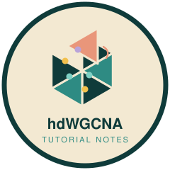

# hdWGCNA: study notes 

**My worked tutorial for co-expression network analysis of single-cell data with hdWGCNA**

In October 2025 I worked through the [hdWGCNA](https://github.com/smorabit/hdWGCNA) basic tutorial by Sam Morabito and colleagues, which applies weighted gene co-expression network analysis (WGCNA) to single-cell data. The notebook (`.Rmd`) follows the published tutorial and adds my own notes on how hdWGCNA stores experiments inside a Seurat object, why the object should not be subset after setup, how to run several experiments in one object, and how to choose the metacell size `k`. The rendered [`.md`](1_basic_tutorial.md) can be read directly on GitHub.

## 📚 Notebook

| Notebook | Data | Topics |
|---|---|---|
| [Basic tutorial](1_basic_tutorial.md) | Control human cortex snRNA-seq, 40,039 nuclei ([Zhou et al. 2020](https://doi.org/10.1038/s41591-019-0695-9)) | `SetupForWGCNA`, metacells (`MetacellsByGroups`), soft-power selection, network construction for inhibitory neurons, module eigengenes, eigengene-based connectivity (kME) and hub genes, UCell hub-gene scores, module feature plots, radar plots, correlograms and dot plots |

**Result in brief:** the network for inhibitory neurons used a soft power of 8 (the lowest power with a scale-free fit ≥ 0.8) and identified 20 co-expression modules (INH-M1 to INH-M20).

The notebook was re-rendered in November 2026 with **R 4.5.3**, **Seurat 5.5.1**, **hdWGCNA 0.4.12**, WGCNA 1.74, UCell 2.14.0 and harmony 2.0.5; full versions are in the session info at the end of the notebook. The tutorial text mentions a soft power of 9, from the authors' run; with these package versions the automatic choice was 8.

## 🧠 Skills practiced

- **Co-expression networks for single-cell data:** metacell aggregation to reduce sparsity, soft-power thresholds and scale-free topology, topological overlap and module detection
- **Module interpretation:** module eigengenes, kME connectivity, hub genes and gene-signature scoring (UCell)
- **Working with Seurat objects:** how hdWGCNA stores experiments in `@misc`, and safe workflows for analysing several cell types
- **Visualization:** module feature plots, radar plots, correlograms and Seurat dot plots of module expression

## ▶️ Running the notebook

1. Create the environment (R 4.5 with Seurat, WGCNA, UCell and harmony), then install hdWGCNA and ggradar from GitHub, as described in [`environment.yml`](environment.yml).
2. Download `Zhou_2020_control.rds` (568 MB) from the [Google Drive folder](https://drive.google.com/drive/folders/1yxolklYrwFB9Snwr2Dp_W2eunBxaol4A?usp=sharing) linked in the hdWGCNA tutorial, and place it next to the notebook.
3. Render `1_basic_tutorial.Rmd`. It needs about 30 GB of memory and took 13 minutes here. It writes the network (`TOM/`) and two saved objects (`hdWGCNA_object*.rds`, about 1 GB each); these are not stored in the repository.

## License and credits

- The notebook follows the [hdWGCNA basic tutorial](https://smorabit.github.io/hdWGCNA/articles/basic_tutorial.html) by Sam Morabito and colleagues and remains under **GPL-3.0**, the hdWGCNA license.
- My own notes, the README and the badge are released under the MIT License. See [`NOTICE.md`](NOTICE.md) for details.
- Example data: Zhou et al. (2020) *Nature Medicine* 26:131–142, as processed and shared by the hdWGCNA authors.

**References**
- Morabito S, Reese F, Rahimzadeh N, Miyoshi E, Swarup V (2023). hdWGCNA identifies co-expression networks in high-dimensional transcriptomics data. *Cell Reports Methods* 3:100498.
- Langfelder P, Horvath S (2008). WGCNA: an R package for weighted correlation network analysis. *BMC Bioinformatics* 9:559.

## AI assistance

The README, repository clean-up, link fixes, figure sizing, the re-rendering of the notebook and the badge were prepared with the assistance of Claude Opus 5.5 (Anthropic), used through Claude Code. The study notes were written by Min-Yao Jhu. All changes were reviewed and approved by the author.

## Contact

**Min-Yao Jhu**, Senior Research Scientist, Donald Danforth Plant Science Center · [minyaojhu.com](https://www.minyaojhu.com) · [GitHub](https://github.com/MinYaoJhu)
